# Argaman CRM — User Manual for Browser Agents

This manual is for an AI agent that operates the **Argaman ("ארגמן") CRM** in a real web browser. The agent reads the screen, clicks, types and picks options from lists.

- The app is in **Hebrew** and laid out **right-to-left (RTL)**. Every button, field, menu item and status below is quoted **exactly as it appears on screen**. Match on those Hebrew strings.
- Screenshots are in `screenshots/` (desktop, 1440 px wide, demo data). Your screen will show different data, but the layout is the same.
- If the screen disagrees with this manual, **trust the screen**, stop, and tell the human what differs.

**Contents**

1. [Quick start and golden rules](#1-quick-start-and-golden-rules)
2. [How to identify things](#2-how-to-identify-things)
3. [Screen by screen](#3-screen-by-screen)
4. [Task recipes](#4-task-recipes)
5. [Reference: statuses, units, VAT, stock math](#5-reference-statuses-units-vat-stock-math)
6. [Limitations](#6-limitations)
7. [Browser tips](#7-browser-tips)
8. [Error messages and what to do](#8-error-messages-and-what-to-do)
9. [Troubleshooting](#9-troubleshooting)
10. [Cheat sheet](#10-cheat-sheet)
11. [Appendix: where things live in the code](#appendix-where-things-live-in-the-code)

---

> **About the screenshots:** they were taken from a local copy of the system with fictional demo data (customers such as "אבני הגליל בנייה בע״מ", stones such as "קררה"). Layout and labels match the real system; the data on the real system is different.

## 1. Quick start and golden rules

### 1.1 What the business does

Argaman sells stone and marble to contractors. The work flows like this:

```
קטלוג אבן (stone types)
   └─► מלאי (stock shipments of a stone: size, finish, piece type, how many pieces, prices)
הצעת מחיר (quote) ──"צור הזמנה"──► תעודת הזמנה (order) ──► פריטי הזמנה (production status per line)
                                        └─"צור תעודת משלוח"─► תעודת משלוח (delivery note, one per order)
                                                                  └─► רשימת חייבים (unpaid delivery notes)
לקוחות (customers) own quotes, orders and delivery notes, and can have per-stone special prices.
```

### 1.2 Quick start

1. Open the app. If you see **"כניסה לארגמן CRM"**, log in (§3.1). You land on **דאשבורד**.
2. Use the **right-hand sidebar** to go between sections, or press **Ctrl+K** (⌘K on Mac) for the quick-jump box.
3. Every section's main page has a create button at the **top-left** of the header (for example **"הוסף למלאי"**).
4. Forms save with the button at the **bottom bar** (usually **"שמירה"**). Wait for the green toast at the **bottom-left** corner and for the page to change. Then check the result on screen (§7.5).

### 1.3 Requires explicit human approval

Ask the human first and wait for a clear "yes". Say exactly what will happen, with the numbers. The app's own confirmation dialog does **not** count as the human's approval.

| Action | Where | Why it needs approval |
|---|---|---|
| Delete an order | Orders list → **"מחיקה"** | Cannot be undone. Also deletes its delivery note, gives stock back, and reopens a quote it came from. |
| Delete a quote | Quotes list → **"מחיקה"** | Cannot be undone. |
| Delete an inventory shipment | Inventory list → **"מחיקה"** | Deletes it for good, or marks it **"לא זמין"** if orders use it. |
| Mark a delivery note as paid, or back to unpaid | **"סמן כשולם"** (debtors or delivery edit), or **"סטטוס תשלום"** | Changes money owed and the debtors list. |
| Create a delivery note | Orders list → **"צור תעודת משלוח"** | Moves stock from "reserved" to "supplied" and completes all of the order's items. Only one note per order. |
| Cancel an order, or un-cancel it | Order edit → **"סטטוס"** = **"בוטלה"** | Releases (or re-reserves) stock. |
| Archive a stone | Stone edit → **"ארכיון"** | Can't be restored from the app. |
| Remove a customer special price | Customer page → trash icon | Changes future prices for that customer. |
| Change a customer's tax ID (**ח.פ / ת״ז**) | Customer edit | This is the customer's identity. |
| Change the price of anything that already exists (shipment prices, special prices, quote lines) | Edit screens | Changes money. |
| Convert a quote to an order | **"צור הזמנה"** on a quote | Reserves stock, and may create new shipments. |
| Use **"לא במלאי"** (not in stock) on an order line | Order / convert forms | Creates a new shipment in stock. |
| Set a delivery to **"נמסר"** (delivered) or **"בוטל"** (cancelled) | Delivery edit | **"נמסר"** also marks the order **"הושלמה"**. |
| Lower a shipment's quantity, or set it to **"לא זמין"** | Inventory edit | Changes available stock. |

### 1.4 Never do

- **Never** change tax IDs, prices or quantities to "fix" a mismatch you noticed without asking the human.
- **Never** run bulk actions (several deletes, marking many notes paid, and so on) that were not explicitly requested.
- **Never guess** which customer, stone or shipment is meant. If the request is ambiguous, or a search finds 0 or more than 1 match, stop and ask.
- **Never create a duplicate customer.** Search by tax ID first (§2.1).
- **Never** log out, and never touch other users' sessions, accounts or passwords. The app has no user management; don't look for it.
- **Never** touch anything outside the CRM: browser settings, the database console, the hosting dashboard, email.
- **Never** retry a create or delete action blindly after an error or a timeout. Reload and check first (§7.6).
- **Never** type credentials you were not given. Never repeat them back.

---

## 2. How to identify things

### 2.1 Customers (לקוח)

- **Identify customers by tax ID (ח.פ / ת״ז) first.** It is unique: the system refuses a second customer with the same ID. Names can repeat or be misspelled.
- Find a customer:
  1. Go to **לקוחות**. Type part of the name in **"סנן לפי שם לקוח..."**.
  2. Look at the **"ח.פ / ת״ז"** column and compare it with the ID you were given.
  3. Not found by name? Clear the filter, sort by the **"ח.פ / ת״ז"** header, and look through the rows (the filter only searches names). The page's find (Ctrl+F) also works.
- In forms (order and quote), the **"לקוח"** dropdown shows **names only**. If two customers have the same name, go back to the customers list, open the right one by tax ID, and check its details before choosing.
- **0 matches** → don't create the customer unless asked. Ask the human. **More than 1 plausible match** → ask.

### 2.2 Stones (אבן) and shipments (משלוח במלאי)

- A **stone** is a catalog name plus a color swatch (for example **"קררה"** with a white swatch). Names are unique among active stones.
- An **inventory shipment** is one batch of a stone. It is identified by **stone + finish level (רמת גימור) + piece type (חלק) + dimensions in cm (L×W×H)**. Status and available count help too. The same stone can have many shipments.
- Order forms show shipments as one line of text, for example:
  `זמין 50 קררה פלטה חלק, 60×30×2`
  This means: 50 pieces available · stone קררה · piece type פלטה · finish חלק · 60×30×2 cm.
- Find a stone: **קטלוג אבן** (cards with name and swatch). Find a shipment: **מלאי** → **"סנן לפי שם האבן..."**, then compare the finish, piece and dimension columns.
- Several shipments match, and the human didn't say which one → ask. Never pick by price.

### 2.3 Document numbers

| Document | Shown as | Notes |
|---|---|---|
| Order (תעודת הזמנה) | `#1003`, `הזמנה #1003` | Separate counter starting at 1000 |
| Delivery note (תעודת משלוח) | `#1001`, `תעודת משלוח #1001`, `ת.משלוח #1001` | **Own counter**: a delivery's number is **not** the order's number. The delivery page shows both. |
| Quote (הצעת מחיר) | `#1012`, `הצעה #1012` | Own counter |

- Numbers are never reused. Deleting leaves a gap.
- Web addresses use internal IDs, not these numbers. You **cannot** type `/dashboard/orders/1003`. Find the record in its list and click it.
- To find order #N: **תעודות הזמנה** → sort by the **"מס׳"** header, or filter by customer and read the **"מס׳"** column. The same works for delivery notes and quotes.

### 2.4 When the search finds 0 or more than 1 result

| Situation | What to do |
|---|---|
| 0 results | Check spelling or try fewer letters. Clear the filter. The list may be capped (orders, quotes and delivery notes show only the latest 400; see the footer note **"מוצגות 400 האחרונות בלבד"**). Still nothing → **stop and ask**. |
| More than 1 result, and the request doesn't say which | **Stop and ask.** List the candidates with their distinguishing details (tax ID, number, date, total). |
| Exactly 1 result, but some details differ from the request (different total, different tax ID) | **Stop and ask.** Don't "fix" the data. |

---

## 3. Screen by screen

### Common layout (all screens after login)

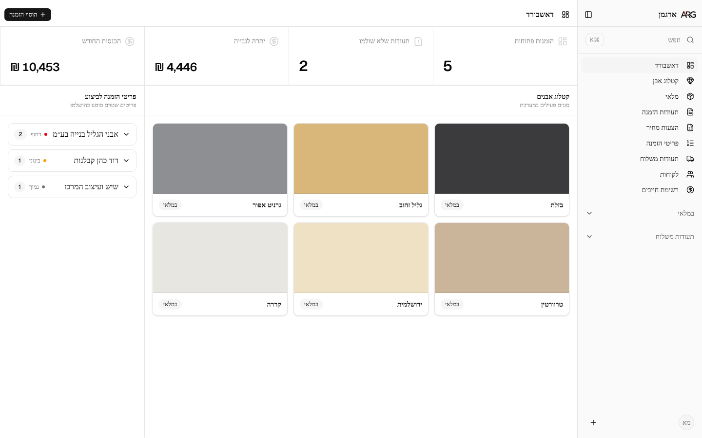

- **Sidebar (right side)**: the logo **"ארגמן"**, a search box **"חפש"**, and the main sections:
  **דאשבורד**, **קטלוג אבן**, **מלאי**, **תעודות הזמנה**, **הצעות מחיר**, **פריטי הזמנה**, **תעודות משלוח**, **לקוחות**, **רשימת חייבים**.
  - Below them are three groups that open when clicked:
    - **"במלאי"**: up to 12 recent shipments with stock, for example `קררה · חלק · פלטה (50 זמין)`.
    - **"לא במלאי"**: up to 12 recent sold-out shipments.
    - **"תעודות משלוח"**: the 8 latest notes, for example `ת.משלוח #1001 — <customer>`.
  - At the bottom: a round avatar with the user's initials (menu: **"פרופיל"** and **"הגדרות"**, which do nothing, and **"יציאה"**, which logs out). Next to it a **"+"** button (**"הוספה מהירה"**) with the menu **"הוסף חדש"**: **"הוסף למלאי"**, **"תעודת הזמנה"**.
- **Header (top)**: the section's icon and title on the right. On a section's main page there is a create button on the left (table below). On narrow screens a button appears in the header to open the sidebar.
- **Toasts**: short messages at the **bottom-left**. They disappear after about 3.5 seconds and have a close ×. Example:

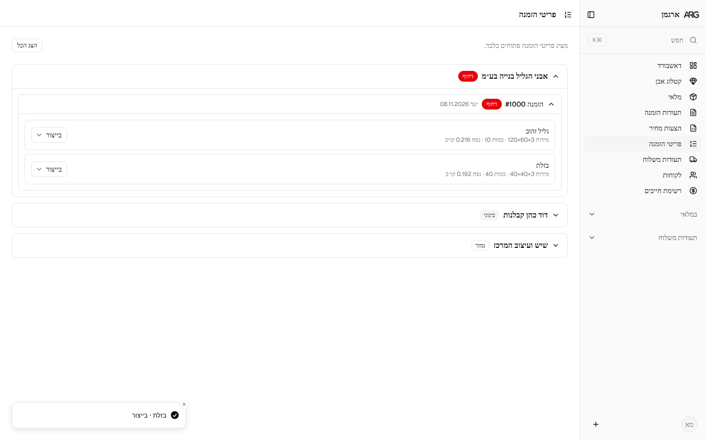

- **Confirmation dialogs**: a box in the middle of the screen with a title, a question, **"ביטול"**, and a confirm button. Clicking outside does nothing. While the action runs, the confirm button shows a spinner and a label such as **"מוחק…"**, and the dialog can't be closed.

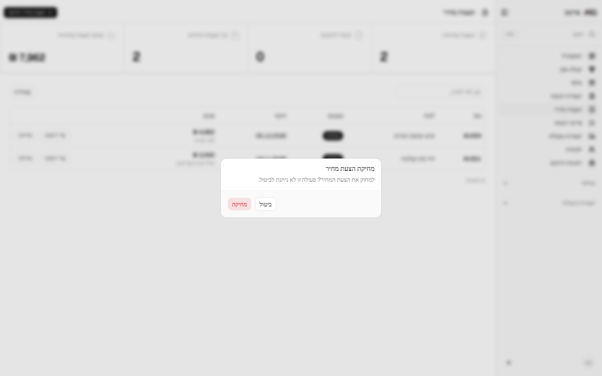

- **Error dialog**: title **"שגיאה"**, the message, and a **"סגירה"** button.

| Section main page | Header create button |
|---|---|
| דאשבורד | **"הוסף הזמנה"** → new order |
| קטלוג אבן | **"אבן חדשה"** |
| מלאי | **"הוסף למלאי"** |
| תעודות הזמנה | **"תעודת הזמנה"** |
| הצעות מחיר | **"הצעת מחיר חדשה"** |
| לקוחות | **"הוסף לקוח"** |
| פריטי הזמנה, תעודות משלוח, רשימת חייבים | none |

**Quick-jump box (command palette)**

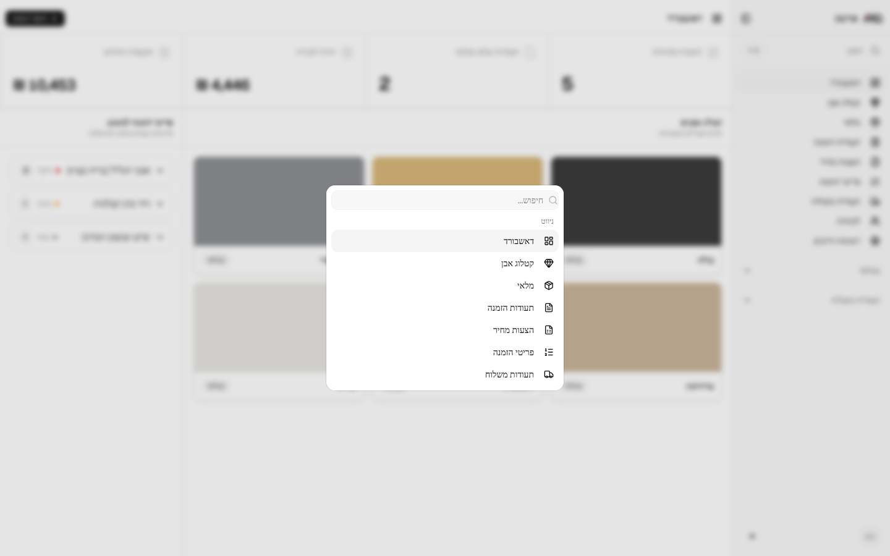

- Open it with **Ctrl+K** / **⌘K**, or click **"חפש"** in the sidebar. The input says **"חיפוש..."**.
- Groups: **"ניווט"** (the 9 sections), **"במלאי"**, **"לא במלאי"**, **"תעודות משלוח"**. These are the same short lists as in the sidebar. If nothing matches: **"לא נמצאו תוצאות"**.
- **It does not search customers, orders or quotes.** Use the section lists for that.

**Data tables** (מלאי, תעודות הזמנה, הצעות מחיר, תעודות משלוח, לקוחות) all work the same way:

- **One filter box** above the table. It searches one fixed column; the placeholder says which.
- **"עמודות"** button (left): show or hide columns. If a column you expect is missing, turn it back on here.
- **Sort**: click a column header. An arrow shows the direction: ↑ ascending, ↓ descending. Clicking again cycles through descending and then back to the default order (newest first).
- **Open a record**: click an empty part of its row, or focus the row and press **Enter**. Ctrl/⌘-click or middle-click opens it in a new tab. Buttons inside a row do their own action and don't open the record.
- **Footer**: **"N רשומות"**, or **"X מתוך N רשומות"** when a filter is on. On orders, quotes and deliveries, when the cap is reached it adds **"· מוצגות 400 האחרונות בלבד"**.
- Empty table: **"אין עדיין רשומות."** (no data yet) or **"אין תוצאות לסינון."** (the filter matched nothing).
- Dates appear as **dd.mm.yyyy**. Overdue dates are **red**.

**Special pages**

- A short grey skeleton may show while a page loads (**"טוען…"**). Wait for it to go away.
- **"הרשומה לא נמצאה"**: the record was deleted or the link is wrong. Link: **"חזרה לדאשבורד"**.
- **"הדף לא נמצא"**: unknown address. Link: **"לדאשבורד"**.
- **"משהו השתבש בטעינת הדף"**: a loading error. Buttons **"נסו שוב"** and **"לדאשבורד"**.
- Inline **"טעינת הנתונים נכשלה. נסו לרענן את הדף."**: a list failed to load. Reload once, then report.

---

### 3.1 Login

**URL** `/login` · 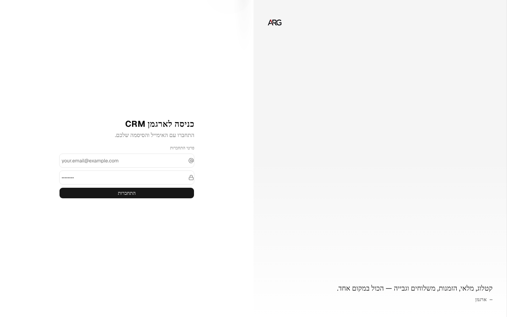

- **Shows**: the title **"כניסה לארגמן CRM"**, the text **"התחברו עם האימייל והסיסמה שלכם."**, the label **"פרטי התחברות"**, an email field (`your.email@example.com`), a password field, and the button **"התחברות"** (shows **"מתחברים…"** while working).
- **Actions**: log in. There is no sign-up and no "forgot password".
- Errors appear in red under the fields, for example **"אימייל או סיסמה שגויים."**
- If you open a dashboard page while logged out, you are sent here with `?next=...`. After logging in you return to that page.

### 3.2 Dashboard — דאשבורד

**URL** `/dashboard` · 

- **KPI cards (top)**:

  | Card | Meaning |
  |---|---|
  | **"הזמנות פתוחות"** | Orders with status פתוחה, בייצור or מוכנה למשלוח |
  | **"תעודות שלא שולמו"** | Number of unpaid delivery notes (cancelled ones not counted) |
  | **"יתרה לגבייה"** | Total ₪ of unpaid delivery notes |
  | **"הכנסות החודש"** | Total ₪ of orders created this month (cancelled orders not counted) |

- **"קטלוג אבנים"** (**"סוגים פעילים במערכת"**): a card for each active stone, with a badge **"במלאי"** if there is stock. Click a card to open the stone edit page.
- **"פריטי הזמנה לביצוע"** (**"פריטים שטרם סומנו כהושלמו"**): up to 40 open order items, grouped by customer. The groups start closed; click a customer to open it. Each item shows the stone, `#order` and **"סטטוס: … · תעדוף הזמנה: …"**. Click an item to open its order. If there are none: **"אין פריטים פתוחים"**.
- **Actions**: the header button **"הוסף הזמנה"**.

### 3.3 Stone catalog — קטלוג אבן

**URL** `/dashboard/stones` · 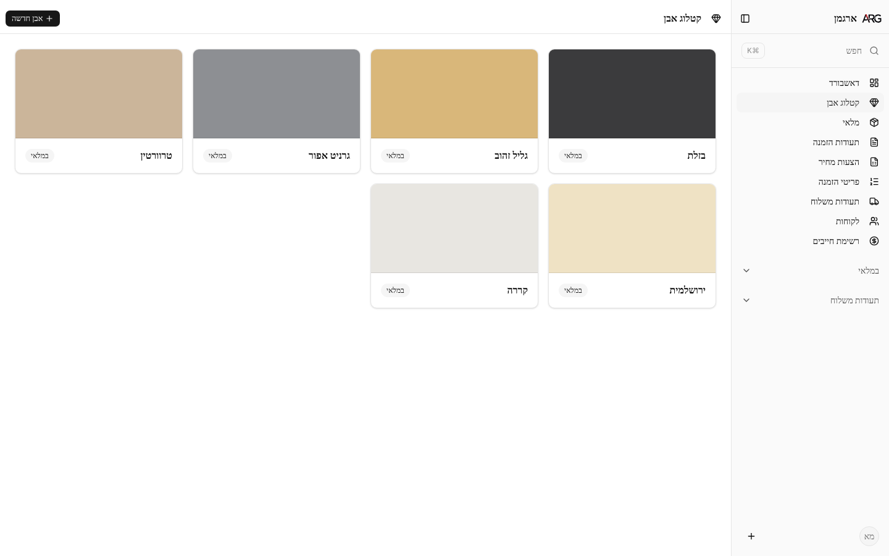

- **Shows**: a grid of active stone cards (color swatch, name, badge **"במלאי"**). When there are none: **"אין אבנים בקטלוג. הוסיפו אבן חדשה."**
- **Actions**: **"אבן חדשה"** (header). Click a card to edit it.

### 3.4 New stone — אבן חדשה

**URL** `/dashboard/stones/new` · 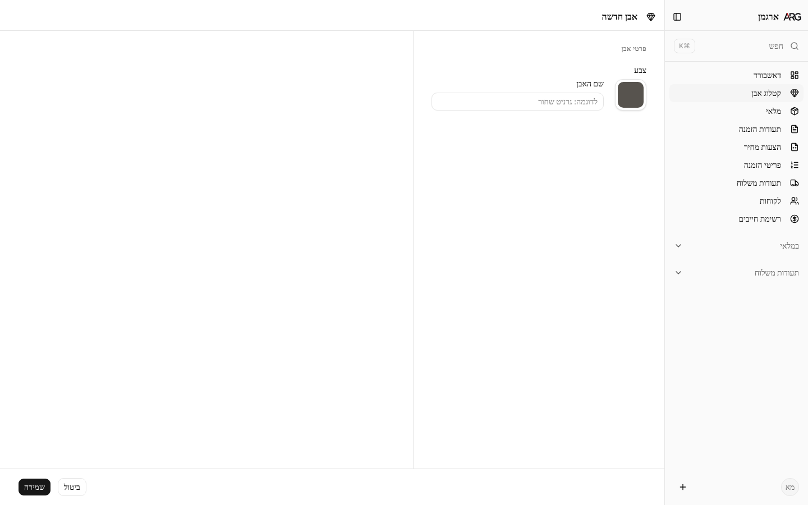

- Section **"פרטי אבן"**: **"צבע"** (a color square, labelled **"בחירת צבע"**) and **"שם האבן"** (placeholder **"לדוגמה: גרניט שחור"**).
- Bottom bar: **"ביטול"**, **"שמירה"** (**"שומר…"** while saving).

### 3.5 Edit stone

**URL** `/dashboard/stones/<id>/edit` · 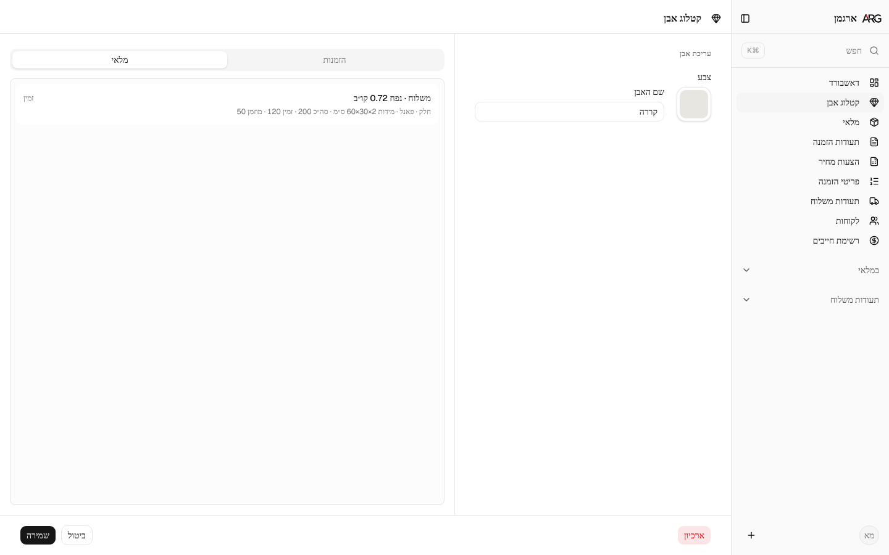

- Left part, section **"עריכת אבן"**: **"צבע"** and **"שם האבן"**.
- Right part, tabs:
  - **"מלאי"**: this stone's shipments, for example `משלוח · נפח 0.18 קו״ב`, status, `מידות … ס״מ · סה״כ … · זמין … · מוזמן …`. Click one to edit it.
  - **"הזמנות"**: orders that use this stone (`הזמנה #N`, status, customer, ₪).
- Bottom bar: red **"ארכיון"** on one side; **"ביטול"** and **"שמירה"** on the other.

### 3.6 Inventory — מלאי

**URL** `/dashboard/inventory` · 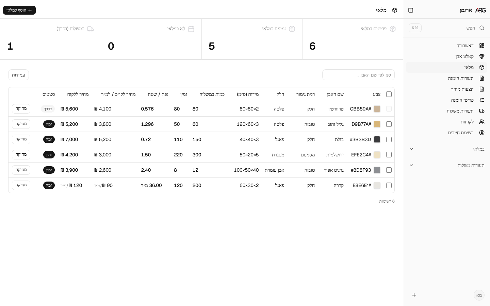

- **KPI cards**: **"פריטים במלאי"** (all shipments), **"זמינים במלאי"** (status זמין with stock), **"לא במלאי"** (לא זמין, or 0 available), **"במשלוח (בדרך)"** (status בדרך).
- **Filter**: **"סנן לפי שם האבן..."**
- **Columns**:

  | Column | Meaning |
  |---|---|
  | (checkbox) | Select the row for a new order. Only rows with status **זמין** and stock above 0 can be selected. The header checkbox is **"בחר הכל"**. |
  | **"צבע"** | Swatch and hex code |
  | **"שם האבן"** | Stone |
  | **"רמת גימור"** | חלק / טובזה / מסמסם |
  | **"חלק"** | פאנל / מסגרת / פלטה / אבן עומדת |
  | **"מידות (ס״מ)"** | L×W×H in cm |
  | **"כמות במשלוח"** | Total pieces in the shipment |
  | **"זמין"** | Pieces still free = total − reserved − supplied |
  | **"נפח / שטח"** | m³ (`0.18`), or m² with the unit (`9.00 מ״ר`) for shipments priced by area |
  | **"מחיר לקו״ב / למ״ר"** | Cost price; `/מ״ר` is added for area pricing |
  | **"מחיר ללקוח"** | Default selling price (per m³, or per m² with `/מ״ר`) |
  | **"סטטוס"** | **זמין** / **לא זמין** / **בדרך** |
  | (actions) | **"מחיקה"** |

- **Actions**: **"הוסף למלאי"** (header); click a row to edit it; **"מחיקה"**; select rows and then **"צור הזמנה (N)"**.

**With rows selected** · 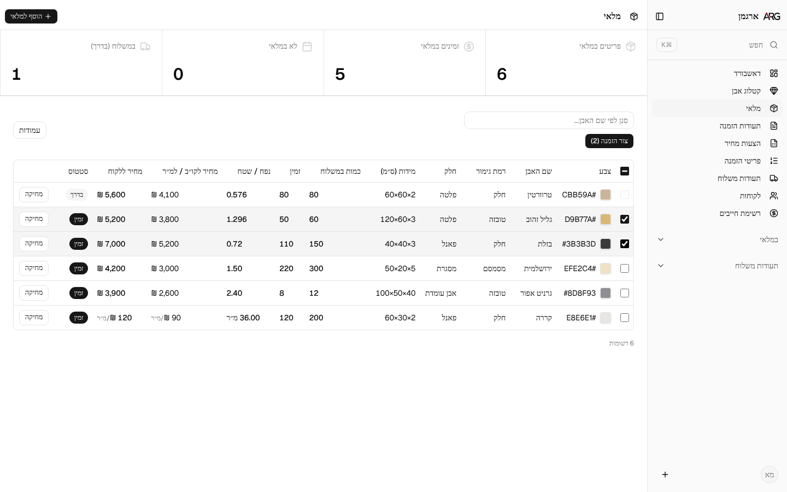

- Once at least one row is ticked, the button **"צור הזמנה (N)"** appears next to the filter. N is the number of selected rows.

### 3.7 Add to inventory — הוסף למלאי

**URL** `/dashboard/inventory/new` · 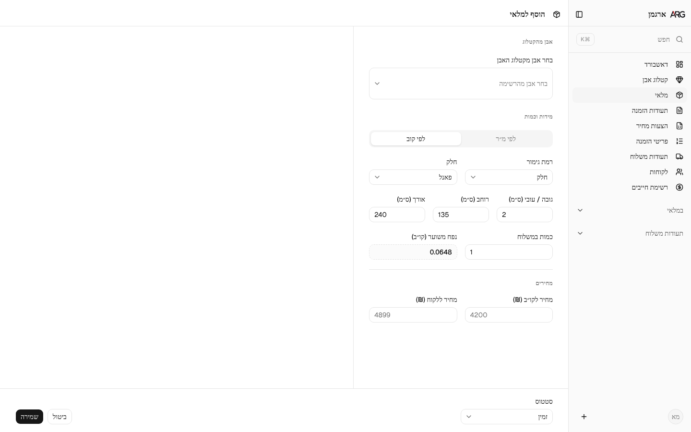

- Section **"אבן מהקטלוג"**: **"בחר אבן מקטלוג האבן"** (dropdown, placeholder **"בחר אבן מהרשימה"**). After you choose, a card shows the swatch and the name.
- Section **"מידות וכמות"**:
  - tabs **"לפי קוב"** / **"לפי מ״ר"**
  - **"רמת גימור"** and **"חלק"**
  - dimensions: **"גובה / עובי (ס״מ)"** (by-volume tab) or **"עובי (ס״מ)"** (by-area tab), then **"רוחב (ס״מ)"** and **"אורך (ס״מ)"**
  - **"כמות במשלוח"**
  - a live preview, **"נפח משוער (קו״ב)"** or **"שטח פנים (מ״ר)"**
- **"מחירים"**: **"מחיר לקו״ב (₪)"** + **"מחיר ללקוח (₪)"** (by volume), or **"מחיר למ״ר (₪)"** + **"מחיר ללקוח למ״ר (₪)"** (by area).
- Bottom bar: **"סטטוס"** (**זמין** / **לא זמין** / **בדרך**), **"תאריך צפי הגעה"** (only when **בדרך**), **"ביטול"**, **"שמירה"**.

### 3.8 Edit inventory shipment

**URL** `/dashboard/inventory/<id>/edit` · 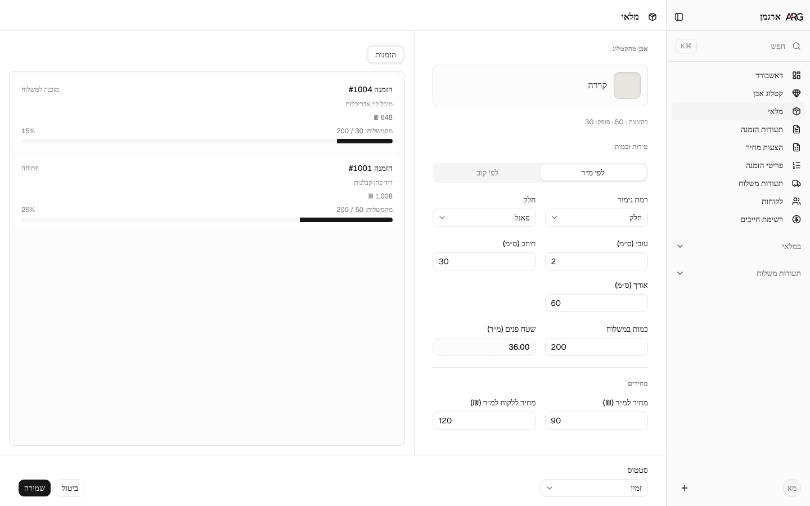

- The same fields as the add form, but the **stone can't be changed** (it is shown read-only). Under the stone you see **"בהזמנה : N · סופק: M"** (reserved / supplied).
- Right panel **"הזמנות"**: orders that use this shipment, with **"מהמשלוח: X / total"** and a progress bar. If there are none: **"אין הזמנות המקושרות למשלוח זה"**.
- Bottom bar: **"סטטוס"**, **"תאריך צפי הגעה"**, **"ביטול"**, **"שמירה"**. There is no delete button here; delete from the list.

### 3.9 Orders — תעודות הזמנה

**URL** `/dashboard/orders` · 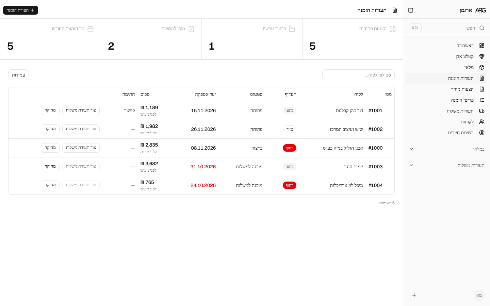

- **KPI cards**: **"הזמנות פתוחות"**, **"בייצור עכשיו"**, **"מוכן למשלוח"**, **"סך הזמנות החודש"**.
- **Filter**: **"סנן לפי לקוח..."**. Shows the latest 400 orders.
- **Columns**:
  - **"מס׳"** (`#1003`)
  - **"לקוח"**
  - **"תעדוף"** badge: נמוך / בינוני / דחוף
  - **"סטטוס"**: פתוחה / בייצור / מוכנה למשלוח / הושלמה / בוטלה
  - **"יעד אספקה"**: red when overdue on an open order
  - **"סכום"**: the total including VAT, with a small note **"כולל מע״מ בפריטים"** or **"לפני מע״מ"** that says how prices were typed (§5.3)
  - **"חתימה"**: a link **"קישור"**, or —
  - actions: **"צור תעודת משלוח"** and **"מחיקה"**
- **"צור תעודת משלוח"** is greyed out when a note already exists (tooltip **"כבר קיימת תעודת משלוח"**) or the order is cancelled (**"ההזמנה בוטלה"**).
- **Actions**: **"תעודת הזמנה"** (header); click a row to open it; create a delivery note; delete.

### 3.10 New order — תעודת הזמנה חדשה

**URL** `/dashboard/orders/new` (also opened with stock rows pre-filled from the inventory selection) · 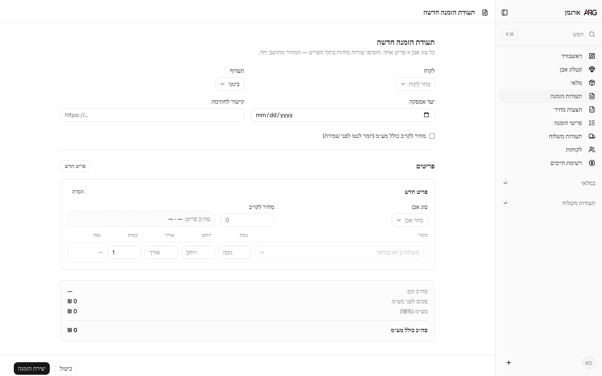

- Title **"תעודת הזמנה חדשה"**, with the hint **"כל סוג אבן = פריט אחד. הוסיפו שורות מידות בתוך הפריט — המחיר מחושב יחד."**
- Header fields:
  - **"לקוח"** (**"בחר לקוח"**)
  - **"תעדוף"** (נמוך / **בינוני** / דחוף)
  - **"יעד אספקה"** (date)
  - **"קישור לחתימה"** (`https://…`)
- Checkbox **"מחיר לקו״ב כולל מע״מ (יומר לנטו לפני שמירה)"**.
- **"פריטים"** with the button **"פריט חדש"**. Each stone gets its own card, titled **"פריט N · <stone>"** (or **"פריט חדש"** before a stone is chosen), with:
  - **"סוג אבן"**, **"מחיר לקו״ב"** (shared by all rows of this stone), and the total **"סה״כ פריט: … קו״ב · ₪"**
  - row headings **מקור · גובה · רוחב · אורך · כמות · נפח**
  - in each row: a source dropdown (**"משלוח / לא במלאי"**: a shipment, or **"לא במלאי"**), the inputs **"גובה"** / **"רוחב"** / **"אורך"** / **"כמות"**, the volume, and **"×"** to remove the row
  - for **"לא במלאי"** rows: two extra dropdowns, **"גימור"** and **"חלק"**
  - **"+ שורה"** adds a row; **"הסרה"** removes the card
- Totals box: **"סה״כ קוב"**, **"סכום לפני מע״מ"**, **"מע״מ (18%)"**, **"סה״כ כולל מע״מ"**.
- Bottom bar: **"ביטול"**, **"יצירת הזמנה"** (**"יוצר…"** while saving).
- If you try to leave or reload the tab with unsaved input, the browser asks "Leave site?". Moving to another page inside the app does **not** warn you.

### 3.11 Order page

**URL** `/dashboard/orders/<id>` · 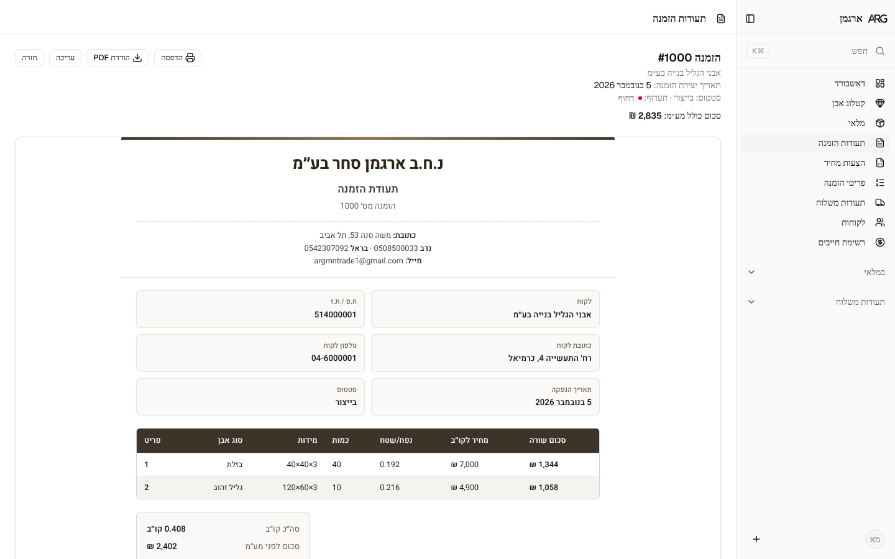

- Header lines:
  - **"הזמנה #N"**
  - the customer
  - **"תאריך יצירת הזמנה: …"**
  - **"סטטוס: … · תעדוף: …"**
  - **"סכום כולל מע״מ: …"**
- Buttons: **"הדפסה"**, **"הורדת PDF"**, **"עריכה"**, **"חזרה"**.
- Below: the printable document **"תעודת הזמנה"**. It shows customer details, the lines (**"פריט"**, **"סוג אבן"**, **"מידות"**, **"כמות"**, **"נפח/שטח"**, **"מחיר לקו״ב"**, **"סכום שורה"**), and the totals.
- There is **no** "create delivery note" button here. That button is only in the orders list.

### 3.12 Edit order

**URL** `/dashboard/orders/<id>/edit` · 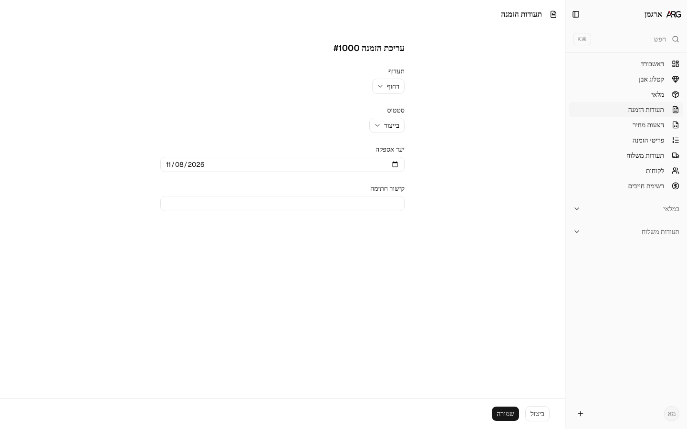

- Title **"עריכת הזמנה #N"**. Fields:
  - **"תעדוף"**
  - **"סטטוס"** (**פתוחה**, **בייצור**, **מוכנה למשלוח**, **הושלמה**, **בוטלה**)
  - **"יעד אספקה"**
  - **"קישור חתימה"**
- Buttons: **"ביטול"**, **"שמירה"**.
- The lines, the customer and the VAT setting **can't** be changed.

### 3.13 Order items — פריטי הזמנה

**URL** `/dashboard/order-items` (`?view=all` shows everything) · 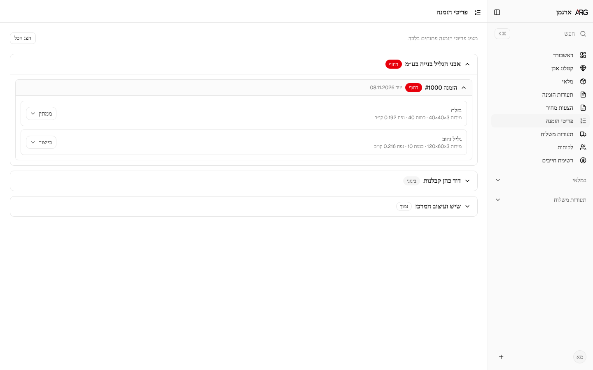

- Top text: **"מציג פריטי הזמנה פתוחים בלבד."** or **"מציג את כל פריטי ההזמנה."**. The button **"הצג הכל"** / **"הצג פתוחים"** switches between them.
- Three levels, all closed at first: customer (with its most urgent priority badge) → **"הזמנה #N"** (priority, **"יעד <date>"**) → item rows. An item row shows the stone, **"מידות … · כמות … · נפח … קו״ב"**, and a **status dropdown**: **ממתין** / **בייצור** / **הושלם**.
- Changing the dropdown **saves immediately**.
- Empty: **"אין פריטי הזמנה פתוחים."** or **"אין פריטי הזמנה."**

### 3.14 Delivery notes — תעודות משלוח

**URL** `/dashboard/deliveries` · 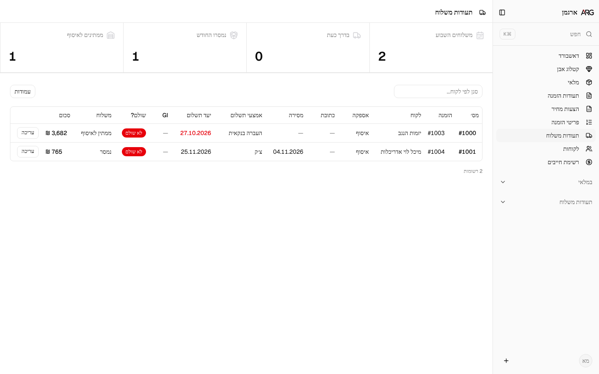

- **KPI cards**: **"משלוחים השבוע"**, **"בדרך כעת"**, **"נמסרו החודש"**, **"ממתינים לאיסוף"**.
- **Filter**: **"סנן לפי לקוח..."**. Shows the latest 400 notes.
- **Columns**:
  - **"מס׳"** (the note's number)
  - **"הזמנה"** (the order's number)
  - **"לקוח"**
  - **"אספקה"** (איסוף / שילוח)
  - **"כתובת"**
  - **"מסירה"** (delivered date)
  - **"אמצעי תשלום"** (מזומן / העברה בנקאית / צ׳ק / כרטיס אשראי / אחר)
  - **"יעד תשלום"** (red when unpaid and overdue)
  - **"GI"** (Green Invoice ID)
  - **"שולם?"** badge: **שולם** / **לא שולם**
  - **"משלוח"** (delivery status)
  - **"סכום"**
  - a **"עריכה"** button
- **Actions**: click a row to open the note; **"עריכה"**. There is no create button here: notes are created from orders.

### 3.15 Delivery note page

**URL** `/dashboard/deliveries/<id>` · 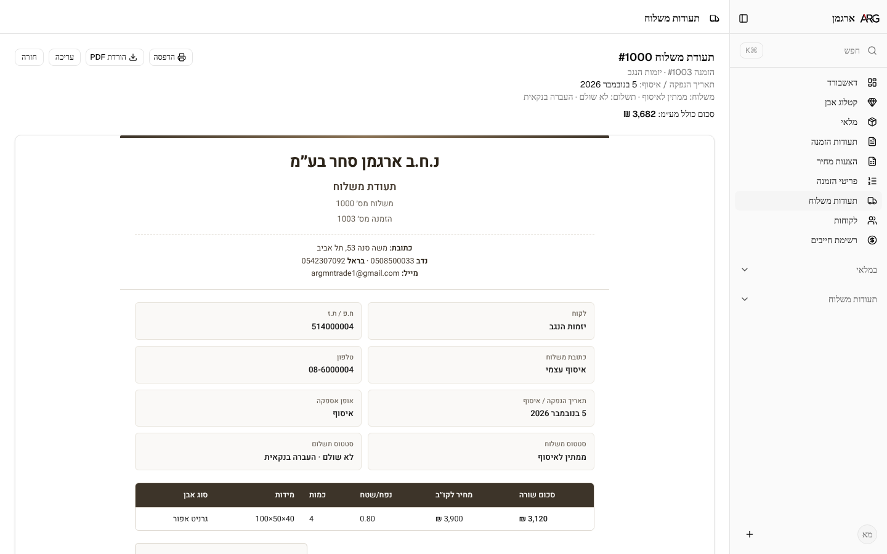

- Header lines:
  - **"תעודת משלוח #N"**
  - **"הזמנה #M · <customer>"**
  - **"תאריך הנפקה / איסוף: …"**
  - **"משלוח: <status> · תשלום: <שולם/לא שולם> · <method>"**
  - **"סכום כולל מע״מ: …"**
  - **"Green Invoice: …"** (only when set)
- Buttons: **"הדפסה"**, **"הורדת PDF"**, **"עריכה"**, **"חזרה"**. Below: the document **"תעודת משלוח"**.

### 3.16 Edit delivery note

**URL** `/dashboard/deliveries/<id>/edit` · 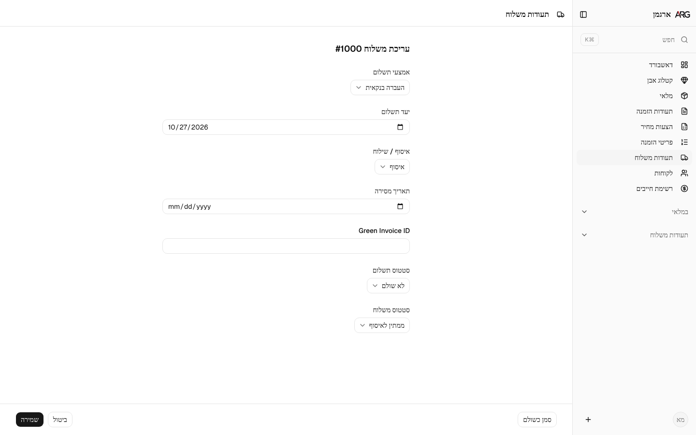

- Title **"עריכת משלוח #N"**. Fields:
  - **"אמצעי תשלום"** (ללא / מזומן / העברה בנקאית / צ׳ק / כרטיס אשראי / אחר)
  - **"יעד תשלום"** (date)
  - **"איסוף / שילוח"** (איסוף / שילוח)
  - **"כתובת משלוח"** (only shown, and then required, for שילוח)
  - **"תאריך מסירה"** (date)
  - **"Green Invoice ID"**
  - **"סטטוס תשלום"** (לא שולם / שולם)
  - **"סטטוס משלוח"** (ממתין לאיסוף / בדרך / נמסר / בוטל)
- Bottom bar: **"סמן כשולם"** on one side; **"ביטול"** and **"שמירה"** on the other.
  - **"סמן כשולם"** asks for confirmation first.
  - Once the note is paid, the button reads **"שולם"** and is greyed out.

### 3.17 Quotes — הצעות מחיר

**URL** `/dashboard/quotes` · 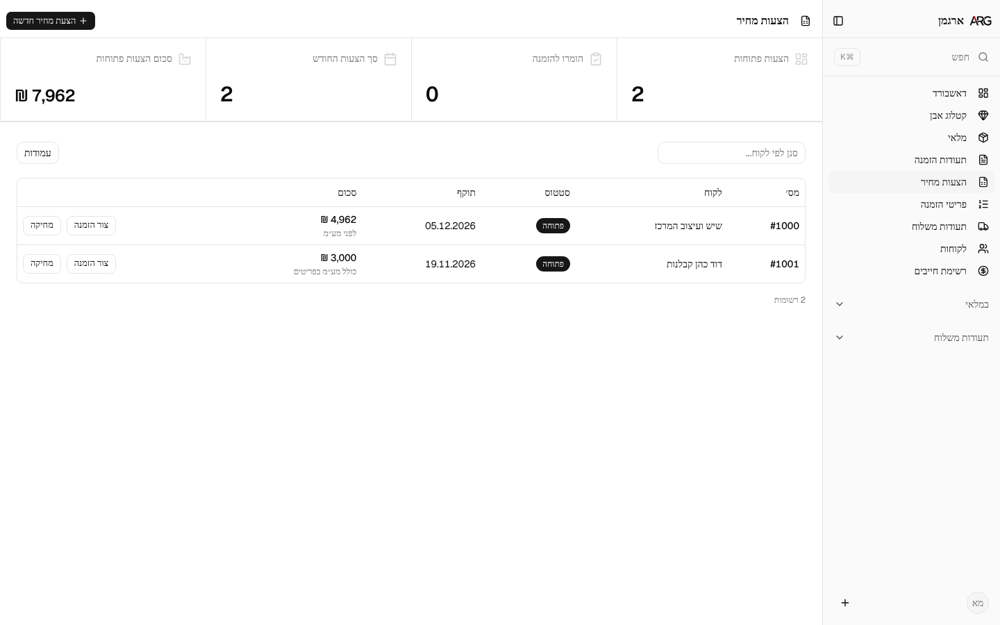

- **KPI cards**: **"הצעות פתוחות"**, **"הומרו להזמנה"**, **"סך הצעות החודש"**, **"סכום הצעות פתוחות"**.
- **Filter**: **"סנן לפי לקוח..."**. Shows the latest 400 quotes.
- **Columns**:
  - **"מס׳"**
  - **"לקוח"**
  - **"סטטוס"** badge (פתוחה / הומרה להזמנה / בוטלה)
  - **"תוקף"** (valid until; red when overdue on an open quote)
  - **"סכום"** (with **"כולל מע״מ בפריטים"** / **"לפני מע״מ"**)
  - actions: **"צור הזמנה"**, **"הזמנה #N"** (link, once converted), **"מחיקה"** (greyed out once converted)
- **Actions**: **"הצעת מחיר חדשה"**; click a row to open the quote; convert; delete.

### 3.18 New or edit quote

**URL** `/dashboard/quotes/new`, `/dashboard/quotes/<id>/edit` · 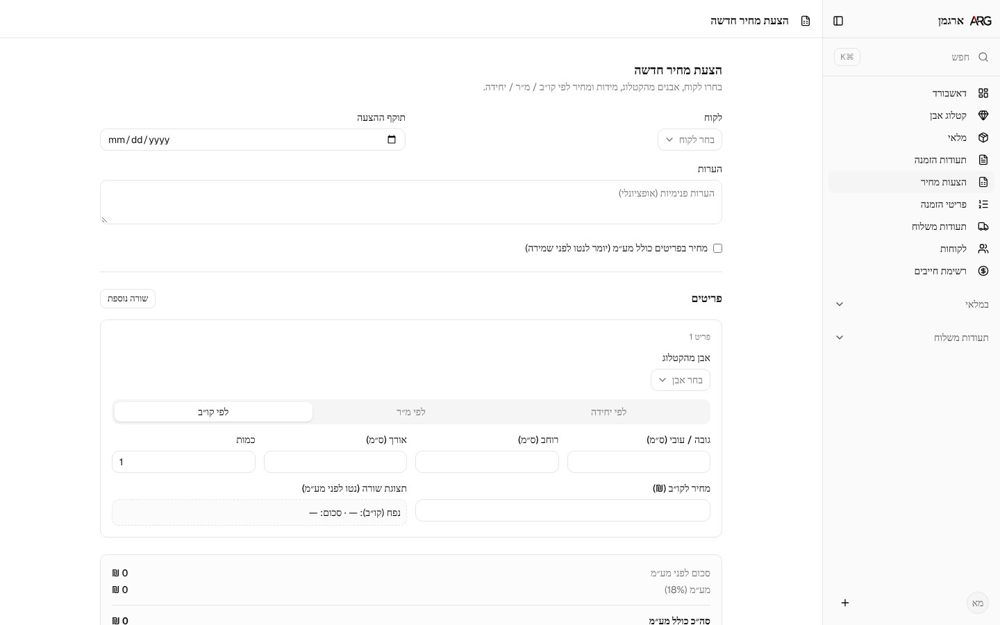

- Title **"הצעת מחיר חדשה"** / **"עריכת הצעת מחיר #N"**, with the hint **"בחרו לקוח, אבנים מהקטלוג, מידות ומחיר לפי קו״ב / מ״ר / יחידה."**
- Header fields:
  - **"לקוח"**
  - **"תוקף ההצעה"** (date)
  - **"הערות"** (**"הערות פנימיות (אופציונלי)"**; these notes are printed on the quote)
- Checkbox **"מחיר בפריטים כולל מע״מ (יומר לנטו לפני שמירה)"**.
- **"פריטים"** with the button **"שורה נוספת"**, which adds a line **at the top**. Each card **"פריט N"** has:
  - **"אבן מהקטלוג"**
  - tabs **"לפי קו״ב"** / **"לפי מ״ר"** / **"לפי יחידה"**
  - dimensions: **"גובה / עובי (ס״מ)"** for by-volume; for by-area and by-unit it is **"גובה / עובי (ס״מ) — לצורך המרה להזמנה"** (placeholder **"ברירת מחדל 2"**)
  - **"רוחב (ס״מ)"**, **"אורך (ס״מ)"**, **"כמות"**
  - the price field (**"מחיר לקו״ב (₪)"** / **"מחיר למ״ר (₪)"** / **"מחיר ליחידה (₪)"**)
  - a line preview (measure · **"סכום:"**)
  - **"הסרה"**
- Totals: **"סה״כ קוב (שורות m³)"**, **"סכום לפני מע״מ"**, **"מע״מ (18%)"**, **"סה״כ כולל מע״מ"**.
- Bottom bar: **"ביטול"**, and **"יצירת הצעה"** or **"שמירת שינויים"**.
- The browser warns before you leave or reload with unsaved input.

### 3.19 Quote page

**URL** `/dashboard/quotes/<id>` · 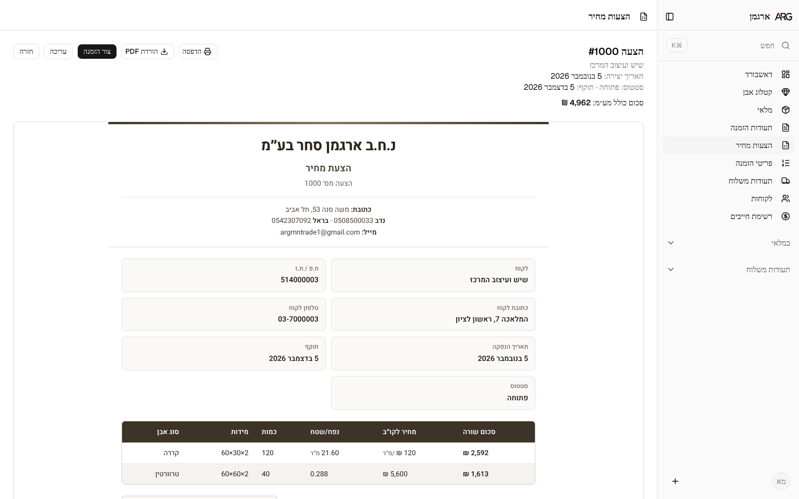

- Header lines:
  - **"הצעה #N"**
  - the customer
  - **"תאריך יצירה: …"**
  - **"סטטוס: … · תוקף: …"**
  - **"הזמנה: #M"** (link, once converted)
  - **"סכום כולל מע״מ: …"**
- Buttons: **"הדפסה"**, **"הורדת PDF"**, **"צור הזמנה"** (only while the quote is open and not converted), **"עריכה"** (only while open), **"חזרה"**. Below: the document **"הצעת מחיר"**.

### 3.20 Convert quote to order

**URL** `/dashboard/quotes/<id>/convert` · 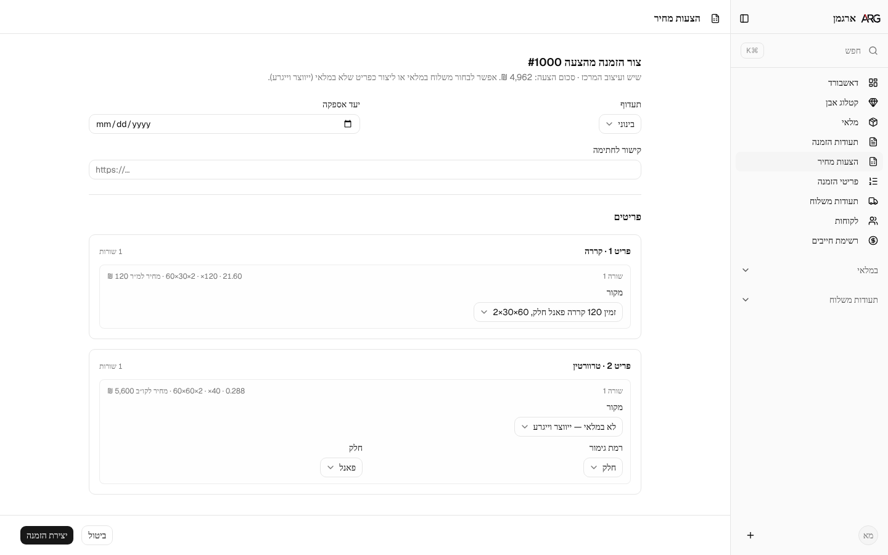

- Title **"צור הזמנה מהצעה #N"**, with **"<customer> · סכום הצעה: … אפשר לבחור משלוח במלאי או ליצור כפריט שלא במלאי (ייווצר וייגרע)."**
- Fields: **"תעדוף"**, **"יעד אספקה"**, **"קישור לחתימה"**.
- **"פריטים"**: one card per stone (**"פריט N · <stone>"**, **"K שורות"**). Each **"שורה N"** shows its dimensions · ×quantity · measure · price, and a **"מקור"** dropdown (**"בחר משלוח או לא במלאי"**):
  - a shipment that has **at least the line's quantity** available, or
  - **"לא במלאי — ייווצר וייגרע"**, which adds the fields **"רמת גימור"** and **"חלק"**
- Bottom bar: **"ביטול"**, **"יצירת הזמנה"** (**"יוצר הזמנה…"** while saving).

### 3.21 Customers — לקוחות

**URL** `/dashboard/customers` · 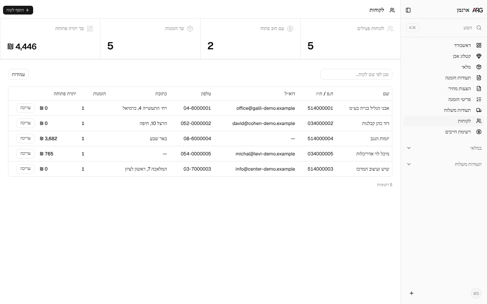

- **KPI cards**: **"לקוחות פעילים"**, **"עם חוב פתוח"**, **"סך הזמנות"**, **"סך יתרה פתוחה"**.
- **Filter**: **"סנן לפי שם לקוח..."**
- **Columns**: **"שם"**, **"ח.פ / ת״ז"**, **"דוא״ל"**, **"טלפון"**, **"כתובת"**, **"הזמנות"** (count), **"יתרה פתוחה"** (unpaid ₪), and an **"עריכה"** button.
- **Actions**: **"הוסף לקוח"**; click a row to open the customer page; **"עריכה"**.

### 3.22 New customer / edit customer

**URL** `/dashboard/customers/new`, `/dashboard/customers/<id>/edit` · 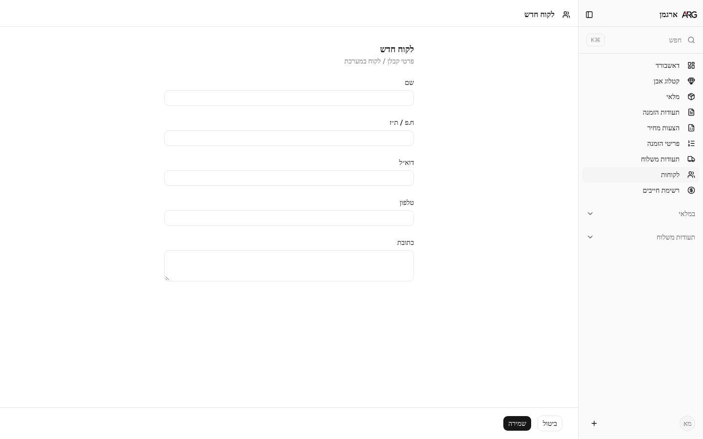

- Title **"לקוח חדש"** (with **"פרטי קבלן / לקוח במערכת"**) or **"עריכת לקוח"**.
- Fields: **"שם"**, **"ח.פ / ת״ז"**, **"דוא״ל"**, **"טלפון"**, **"כתובת"**.
- Buttons: **"ביטול"**, **"שמירה"**.

### 3.23 Customer page

**URL** `/dashboard/customers/<id>` · 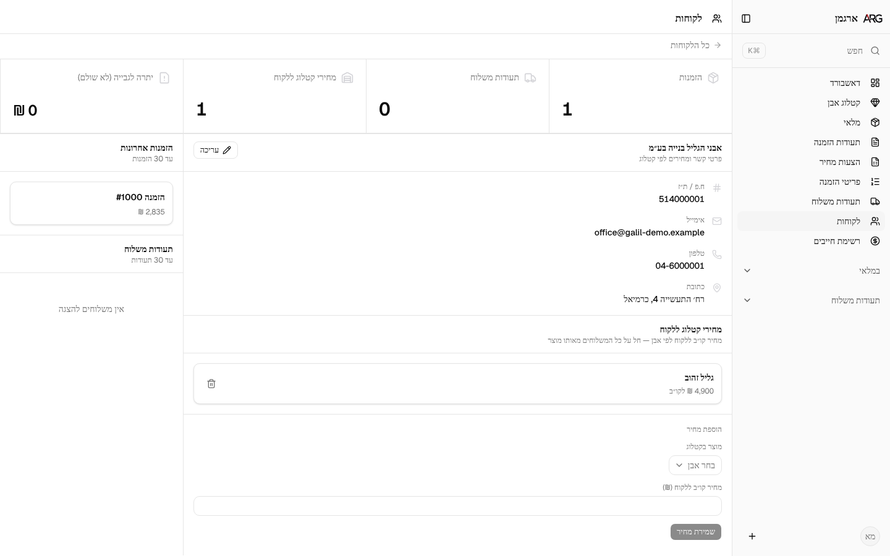

- Link **"כל הלקוחות"** (back to the list).
- **KPI cards**: **"הזמנות"**, **"תעודות משלוח"**, **"מחירי קטלוג ללקוח"**, **"יתרה לגבייה (לא שולם)"**.
- Details: the name, **"עריכה"**, **"ח.פ / ת״ז"**, **"אימייל"**, **"טלפון"**, **"כתובת"**. A badge **"לא פעיל"** appears if the customer is archived.
- **"מחירי קטלוג ללקוח"** (**"מחיר קו״ב ללקוח לפי אבן — חל על כל המשלוחים מאותו מוצר"**):
  - Each price shows as `<stone>` · `<price> לקו״ב`, with a trash icon (**"הסרה"**).
  - Below the list, **"הוספת מחיר"**: **"מוצר בקטלוג"** (**"בחר אבן"**), **"מחיר קו״ב ללקוח (₪)"**, and the button **"שמירת מחיר"**.
  - If there are none: **"אין מחירים מיוחדים — הוסיפו בהוספת מחיר למטה"**.
- **"הזמנות אחרונות"** (up to 30) and **"תעודות משלוח"** (up to 30, with **"שולם"** / **"לא שולם"** badges). Click to open.

### 3.24 Debtors — רשימת חייבים

**URL** `/dashboard/debtors` · 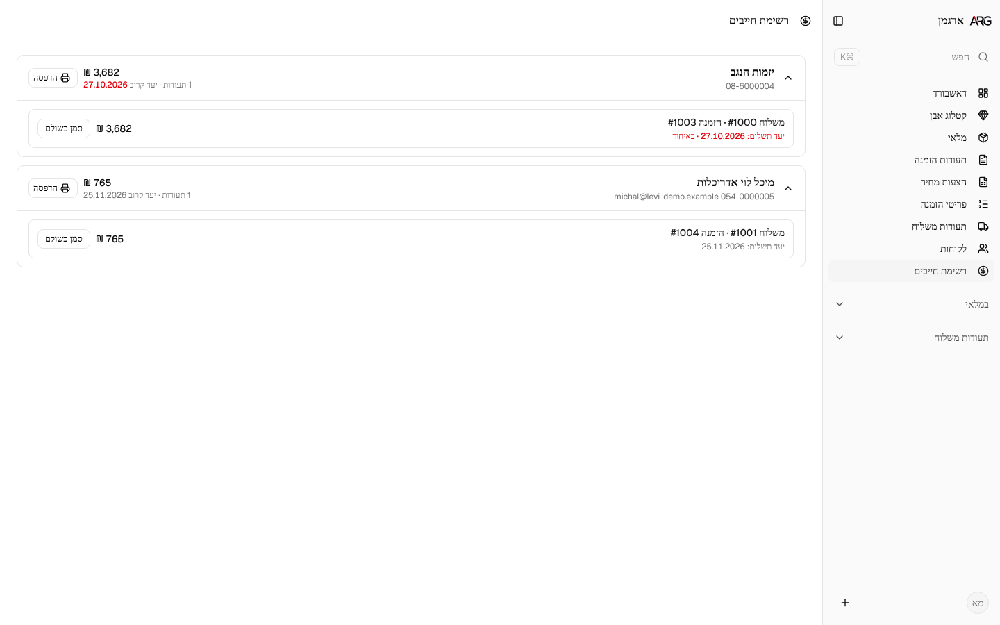

- **Shows**: one card per customer with unpaid, non-cancelled delivery notes. Cards start open; click the header to fold one.
  - Card header: the customer name, phone and email, the total owed, **"N תעודות · יעד קרוב <dd.mm.yyyy>"** (red if overdue), and a **"הדפסה"** button.
  - Each note: the link **"משלוח #N · הזמנה #M"**, **"יעד תשלום: <date>"** (plus **" · באיחור"** in red when overdue), the amount, and **"סמן כשולם"**.
- When nothing is owed: **"אין חובות פתוחים לפי תעודות משלוח."**

### 3.25 Debt summary print dialog

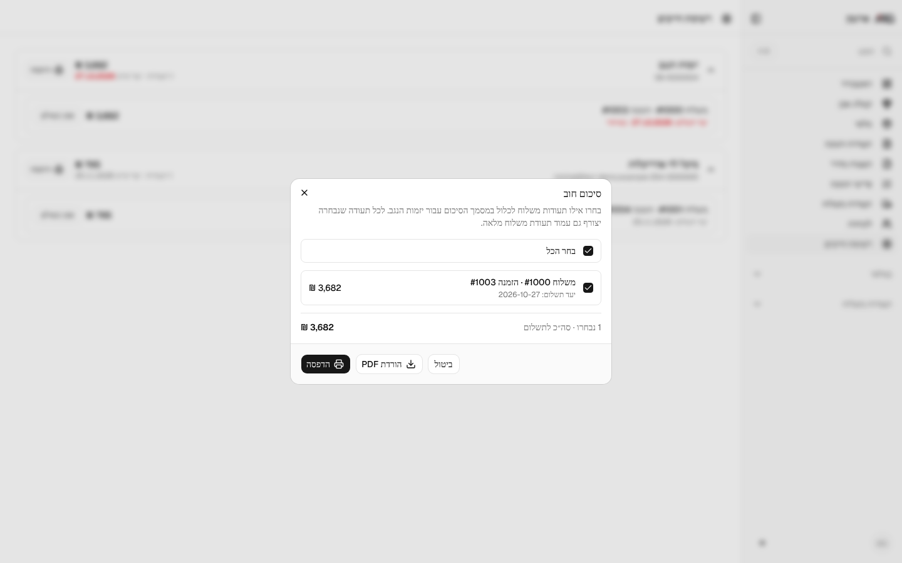

- Opened from **"הדפסה"** on a debtor card. Title **"סיכום חוב"**, with the text **"בחרו אילו תעודות משלוח לכלול במסמך הסיכום עבור <customer>. לכל תעודה שנבחרה יצורף גם עמוד תעודת משלוח מלאה."**
- **"בחר הכל"**, a checkbox per note (`משלוח #N · הזמנה #M`, **"יעד תשלום: …"**, amount), and **"N נבחרו · סה״כ לתשלום"** with the sum.
- Buttons: **"ביטול"**, **"הורדת PDF"** (**"מוריד…"** while working), **"הדפסה"** (**"מדפיס…"**). The dialog can't be closed while it is working.

---

## 4. Task recipes

**For every recipe**:
- **Numbers**: type plain digits; for decimals use `.` (§7.3).
- **Dropdowns**: click the field, then click the option (§7.2).
- **After submitting**: wait for the toast **and** for the next page. Then run the verification steps.

> The names, IDs and amounts in the examples are **illustrative demo values**. Use the values the human gives you.

### 4.1 Add inventory (main walkthrough)

**Goal**: record a new shipment of stone in stock.

**Required fields**

| Field (screen label) | Required? | Format | Example |
|---|---|---|---|
| **"בחר אבן מקטלוג האבן"** | Yes | Pick from the list (active stones) | **קררה** |
| Tab **"לפי קוב"** / **"לפי מ״ר"** | Yes (default **"לפי קוב"**) | Click a tab | **"לפי מ״ר"** |
| **"רמת גימור"** | Yes (default חלק) | חלק / טובזה / מסמסם | **חלק** |
| **"חלק"** | Yes (default פאנל) | פאנל / מסגרת / פלטה / אבן עומדת | **פאנל** |
| **"גובה / עובי (ס״מ)"** (by volume) or **"עובי (ס״מ)"** (by area) | By volume: yes. By area: optional (empty = 2) | cm, > 0, decimals with `.` | **2** |
| **"רוחב (ס״מ)"** | Yes | cm, > 0 | **30** |
| **"אורך (ס״מ)"** | Yes | cm, > 0 | **60** |
| **"כמות במשלוח"** | Yes (default 1) | Whole number > 0 (pieces) | **50** |
| **"מחיר לקו״ב (₪)"** or **"מחיר למ״ר (₪)"** | Yes | ₪, ≥ 0, digits only | **90** (per m²) |
| **"מחיר ללקוח (₪)"** or **"מחיר ללקוח למ״ר (₪)"** | Yes | ₪, ≥ 0 | **120** (per m²) |
| **"סטטוס"** | Yes (default זמין) | זמין / לא זמין / בדרך | **זמין** |
| **"תאריך צפי הגעה"** | Only when **בדרך** | Date | — |

**Steps (worked example: 50 Carrara slabs, 60×30×2 cm, priced by area)**

1. Go to **מלאי**, then click **"הוסף למלאי"** in the header. Or use sidebar **"+"** → **"הוסף למלאי"**.
2. Click **"בחר אבן מקטלוג האבן"**, then click **"קררה"**. A card with the Carrara swatch appears.
   If **קררה** isn't in the list: the stone doesn't exist or is archived. Stop and ask (adding a stone is §4.2).
3. Click the tab **"לפי מ״ר"**. Pick the tab **before** typing prices: switching tabs converts prices that are already typed.
4. **"רמת גימור"**: click it and choose **חלק** (already the default).
5. **"חלק"**: click it and choose **פאנל** (already the default).
6. Dimensions (the form starts with 240 / 135 / 2; select each field's content and replace it):
   - **"עובי (ס״מ)"**: `2`
   - **"רוחב (ס״מ)"**: `30`
   - **"אורך (ס״מ)"**: `60`
7. **"כמות במשלוח"**: `50`.
8. Check the preview **"שטח פנים (מ״ר)"**. It should show **9.00** (0.60 m × 0.30 m × 50).
   If it shows something like 90 000 or 0.09, the dimensions were typed in the wrong unit. Fix them.
9. **"מחיר למ״ר (₪)"**: `90`. **"מחיר ללקוח למ״ר (₪)"**: `120`. Don't type `₪` or a thousands comma.
10. Bottom bar **"סטטוס"**: leave **זמין**.
    For goods still on the way, choose **בדרך** and fill **"תאריך צפי הגעה"**.
11. Click **"שמירה"** and wait (the button shows **"שומר…"**).

This is how the form looks right before step 11:

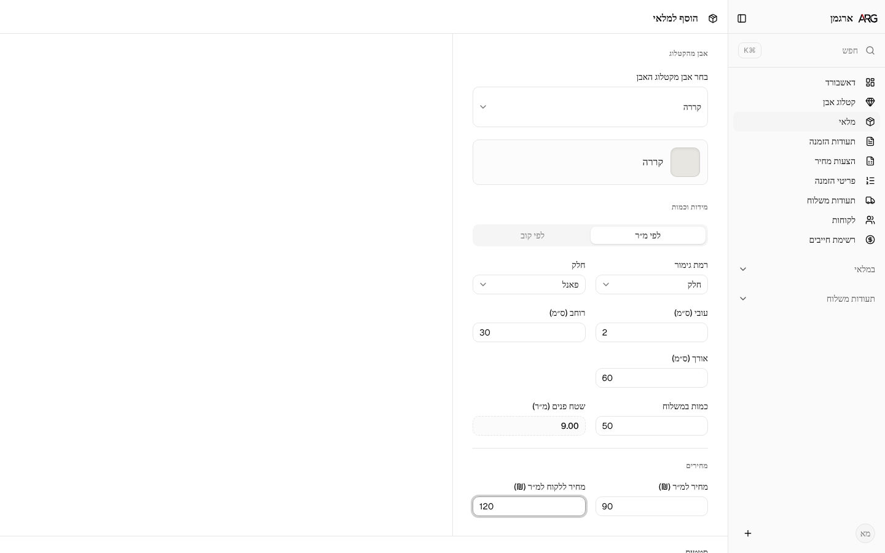

**How to verify success**

- A toast **"הפריט נוסף למלאי"** appears (bottom-left), and you land on the **מלאי** list. The new shipment appears at the top of the table:

  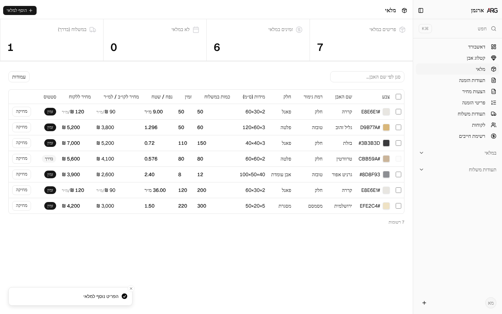

- Type `קררה` in **"סנן לפי שם האבן..."**. The new row should show:

  | Column | Expected |
  |---|---|
  | **"רמת גימור"** / **"חלק"** | חלק / פאנל |
  | **"מידות (ס״מ)"** | 60×30×2 |
  | **"כמות במשלוח"** / **"זמין"** | 50 / 50 |
  | **"נפח / שטח"** | 9.00 מ״ר |
  | **"מחיר לקו״ב / למ״ר"** | 90 ₪/מ״ר |
  | **"מחיר ללקוח"** | 120 ₪/מ״ר |
  | **"סטטוס"** | זמין |

- KPI cards: **"פריטים במלאי"** +1. **"זמינים במלאי"** +1 (if זמין). **"במשלוח (בדרך)"** +1 (if בדרך).
- The sidebar group **"במלאי"** lists `קררה · חלק · פאנל (50 זמין)`.
- Good to know: the system also stores per-m³ prices for this shipment (4,500 and 6,000 ₪, which is the m² price ÷ 0.02 m). Orders use the per-m³ price (§5.2).

**Common errors**

| Message | Fix |
|---|---|
| **"בסטטוס ״בדרך״ חובה תאריך צפי הגעה"** | Fill **"תאריך צפי הגעה"**, or choose a different status. |
| **"חובה מחיר לקו״ב"** / **"חובה מחיר למ״ר"** | Fill the price field of the selected tab. |
| **"המידות חייבות להיות גדולות מאפס."** / **"הכמות חייבת להיות גדולה מאפס."** | Correct the value. |
| Nothing happens on **"שמירה"** | Probably no stone was chosen. Pick one. |

### 4.2 Add a stone to the catalog

| Field | Required? | Format | Example |
|---|---|---|---|
| **"שם האבן"** | Yes | Text, unique among active stones | **קררה** |
| **"צבע"** | Yes (default grey) | Color picker → `#rrggbb` | `#f2f0eb` |

Steps:

1. Go to **קטלוג אבן** and click **"אבן חדשה"**.
2. Click the **"צבע"** square and set the color (§7.4). If you can't, keep the default and tell the human.
3. Type `קררה` in **"שם האבן"**.
4. Click **"שמירה"**.

Verify:
- Toast **"האבן נוספה לקטלוג"**, and you land on **קטלוג אבן**.
- A **קררה** card appears (no **"במלאי"** badge until stock is added).
- The stone is now available in all stone dropdowns.

Errors:
- **"כבר קיימת אבן פעילה בשם זה בקטלוג."**: it already exists. Use it, don't rename.
- **"שם חובה"**: type a name.

**Edit a stone**:
1. Click its card.
2. Change **"צבע"** and/or **"שם האבן"**.
3. Click **"שמירה"** → toast **"האבן עודכנה"**.

Renaming changes the name everywhere, except on delivery notes that were already created.

**Archive a stone** (needs approval):
1. Open the stone and click **"ארכיון"**.
2. The dialog **"ארכיון אבן"** asks **"להפסיק להציג את האבן בקטלוג?"**. Click **"ארכיון"** (it shows **"מעביר…"**).
3. Toast **"האבן הועברה לארכיון"**, and you return to the catalog.

The stone disappears from the catalog and from every dropdown. There is **no un-archive**. Its existing shipments and orders stay.

### 4.3 Add a customer

| Field | Required? | Format | Example |
|---|---|---|---|
| **"שם"** | Yes | Text | **אבי בניה בע״מ** |
| **"ח.פ / ת״ז"** | Yes | Text (digits); unique | **514000099** |
| **"דוא״ל"** | No | Valid email | `avi@example.com` |
| **"טלפון"** | No | Free text | `050-1234567` |
| **"כתובת"** | No | Free text (several lines) | `הרצל 1, חיפה` |

Steps:

1. **First check that the customer doesn't already exist**: in **לקוחות**, filter by name and look at the **"ח.פ / ת״ז"** column (§2.1). If it exists, stop and tell the human.
2. Click **"הוסף לקוח"**.
3. Fill the fields.
4. Click **"שמירה"**.

Verify:
- Toast **"הלקוח נוסף"**, and you land on the **לקוחות** list.
- Filter by the name: the row shows the tax ID you typed, **"הזמנות"** 0 and **"יתרה פתוחה"** 0 ₪.
- **"לקוחות פעילים"** +1.

Errors:
- **"כבר קיים לקוח עם ח.פ / ת״ז זה."**: the customer exists (it may be archived). **Don't** change the ID to get around this. Ask. This is how the error looks (here, trying to add a customer whose tax ID 514000001 already belongs to "אבני הגליל בנייה בע״מ"):

  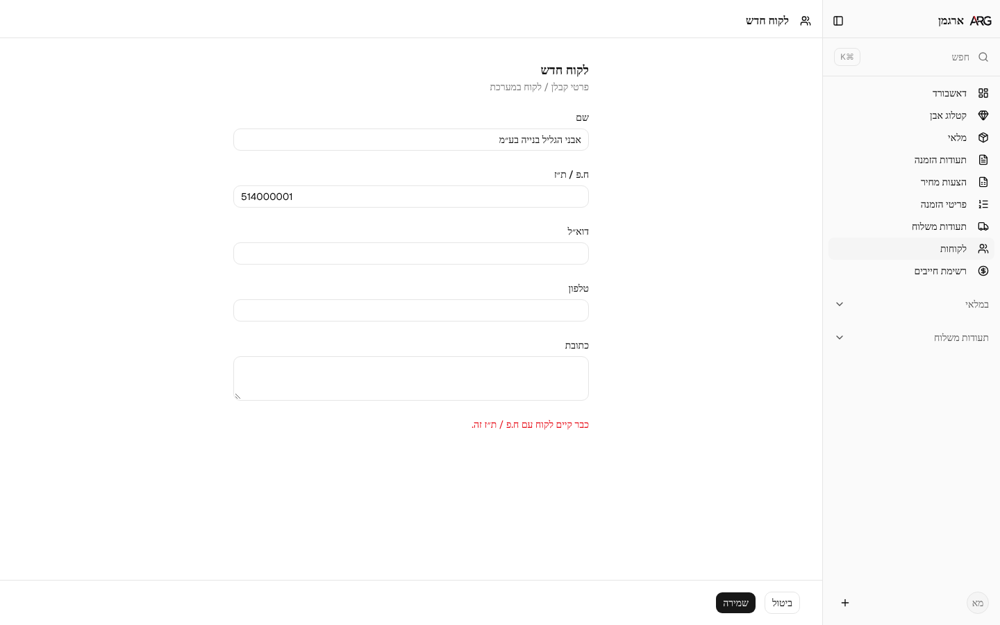
- **"אימייל לא תקין"**: fix the email or leave it empty.

**Edit a customer**:
1. In the list click **"עריכה"**, or open the customer and click **"עריכה"**.
2. Change the fields.
3. Click **"שמירה"** → toast **"פרטי הלקוח עודכנו"**, and you land on the customer page.

Changing **"ח.פ / ת״ז"** needs approval.

### 4.4 Customer special price (מחיר מיוחד)

A special price is a per-customer price **per m³** for one stone. On **new** orders it replaces the shipment's default customer price. On new quotes it applies only to lines priced **"לפי קו״ב"**. Existing documents don't change.

| Field | Required? | Format | Example |
|---|---|---|---|
| **"מוצר בקטלוג"** | Yes | Pick a stone | **קררה** |
| **"מחיר קו״ב ללקוח (₪)"** | Yes | Number > 0, per m³ | **11000** (equals 220 ₪/מ״ר at 2 cm thickness) |

Steps:

1. Open the customer (**לקוחות** → click the row).
2. Scroll to **"מחירי קטלוג ללקוח"** → **"הוספת מחיר"**.
3. Click **"מוצר בקטלוג"** and choose **קררה**.
4. Type `11000` in **"מחיר קו״ב ללקוח (₪)"**.
5. Click **"שמירת מחיר"**. It stays greyed out until both fields are valid.

Verify:
- Toast **"המחיר המיוחד נשמר"**.
- The list shows `קררה` · `11,000 ₪ לקו״ב`.
- The **"מחירי קטלוג ללקוח"** KPI counts it.

If the stone already had a special price, the old one is **replaced**. Replacing an existing price needs approval.

**Remove** (needs approval):
1. Click the trash icon on the row.
2. The dialog **"הסרת מחיר מיוחד"** asks **"להסיר את המחיר המיוחד ל״קררה״? הלקוח יחזור למחיר הרגיל במלאי."**. Click **"הסרה"** (**"מסיר…"**).
3. Toast **"המחיר המיוחד הוסר"**, and the row disappears.

### 4.5 Create a quote

| Field | Required? | Format | Example |
|---|---|---|---|
| **"לקוח"** | Yes | Pick (names only; §2.1) | **אבי בניה בע״מ** |
| **"תוקף ההצעה"** | No | Date | 30 days from today |
| **"הערות"** | No | Text (printed on the quote) | — |
| VAT checkbox | No (default: prices are before VAT) | Checkbox | unchecked |
| Line: **"אבן מהקטלוג"** | Yes | Pick | **קררה** |
| Line: pricing tab | Yes (default **"לפי קו״ב"**) | Tab | **"לפי מ״ר"** |
| Line: thickness | By volume: yes. Otherwise optional (default 2), but used later when converting | cm | **2** |
| Line: **"רוחב (ס״מ)"**, **"אורך (ס״מ)"** | Yes | cm > 0 | **30**, **60** |
| Line: **"כמות"** | Yes (default 1) | Whole number > 0 | **50** |
| Line: price | Yes | ₪ ≥ 0 per chosen unit | **240** (per m²) |

Steps:

1. Go to **הצעות מחיר** and click **"הצעת מחיר חדשה"**.
2. Click **"לקוח"** and choose the customer.
3. Optional: **"תוקף ההצעה"** and **"הערות"**.
4. Decide on the VAT checkbox **before** typing prices (§5.3).
5. In **"פריט 1"**:
   1. **"אבן מהקטלוג"** → **קררה**.
   2. Click the tab **"לפי מ״ר"**. Switching tabs clears the price field.
   3. Thickness `2`, **"רוחב (ס״מ)"** `30`, **"אורך (ס״מ)"** `60`, **"כמות"** `50`.
   4. **"מחיר למ״ר (₪)"**: `240`.
6. For more lines, click **"שורה נוספת"**. The new line appears **at the top** and becomes **"פריט 1"**, so read the numbers again.
7. Check the totals:
   - **"סכום לפני מע״מ"**: 2,160 ₪ (9 m² × 240)
   - **"מע״מ (18%)"**: 388.80 ₪, shown rounded to 389 ₪
   - **"סה״כ כולל מע״מ"**: 2,548.80 ₪, shown rounded to 2,549 ₪
8. Click **"יצירת הצעה"**.

Verify:
- Toast **"הצעת המחיר נוצרה"**, and you land on the quote page **"הצעה #N"**.
- It shows **"סטטוס: פתוחה"** and the matching total.
- In the **הצעות מחיר** list: a new row, and **"הצעות פתוחות"** +1.
- Stock does **not** change (quotes don't reserve anything).

**Edit**: only while the quote is **"פתוחה"**.
1. On the quote page click **"עריכה"**.
2. Make the changes.
3. Click **"שמירת שינויים"** → toast **"הצעת המחיר עודכנה"**.

Errors:
- **"נא לבחור לקוח"**, **"פריט N: חסרה בחירת אבן"**, **"פריט N: חסרות אורך/רוחב תקינים"**, **"פריט N: חסר גובה/עובי תקין"**, **"פריט N: כמות לא תקינה"**, **"פריט N: מחיר לא תקין"**: fix that line.
- **"ניתן לערוך או להמיר רק הצעת מחיר פתוחה."**: the quote has already been converted.

**Delete** (needs approval):
1. In the quotes list click **"מחיקה"**. It is greyed out once converted.
2. The dialog **"מחיקת הצעת מחיר"** asks **"למחוק את הצעת המחיר? פעולה זו לא ניתנת לביטול."**. Click **"מחיקה"** (**"מוחק…"**).
3. Toast **"הצעת מחיר #N נמחקה"**.

### 4.6 Convert a quote into an order (needs approval)

| Field | Required? | Example |
|---|---|---|
| **"תעדוף"** | Yes (default בינוני) | **בינוני** |
| **"יעד אספקה"** | No | a date |
| **"קישור לחתימה"** | No; must start with `http://` or `https://` | — |
| **"מקור"** per line | Yes | `זמין 50 קררה פלטה חלק, 60×30×2` |

Steps:

1. On the quote page click **"צור הזמנה"**. Or use **"צור הזמנה"** on the quote's row in the list.
2. Set **"תעדוף"**, and optionally **"יעד אספקה"** and **"קישור לחתימה"**.
3. For each **"שורה N"**, check the **"מקור"**:
   - If exactly one shipment has enough stock, it is already selected. Check that it is the right one (§2.2).
   - If several fit, the field says **"בחר משלוח או לא במלאי"**. Ask the human which one, unless they already said.
   - If none has enough, **"לא במלאי — ייווצר וייגרע"** is preselected, which **creates a new shipment**. Choose **"רמת גימור"** and **"חלק"** for it. Needs approval.
4. Click **"יצירת הזמנה"** (**"יוצר הזמנה…"**).

Verify:
- Toast **"ההצעה הומרה להזמנה"**, and you land on the new order page **"הזמנה #M"**.
- On the quote: **"סטטוס: הומרה להזמנה"** and a link **"הזמנה: #M"**.
- In **מלאי**, the shipment's **"זמין"** went down by the line quantity (50 → 0 in the example).
- **"הזמנות פתוחות"** +1. **"הצעות פתוחות"** −1 and **"הומרו להזמנה"** +1.
- Prices are converted to per-m³ (240 ₪/מ״ר ÷ 0.02 m = 12,000 ₪/קו״ב), so the order total should match the quote. Small rounding differences are normal. Report them; don't fix them.

Errors:
- **"נא לבחור משלוח או ״לא במלאי״ לפריט: <stone>"**: choose a source.
- **"אין מספיק כמות זמינה במלאי עבור אחד הפריטים."**: someone took the stock meanwhile. Reload and choose again.
- **"ההצעה השתנתה בינתיים — רעננו את הדף ונסו שוב."**: reload.

### 4.7 Create an order

| Field | Required? | Format | Example |
|---|---|---|---|
| **"לקוח"** | Yes | Pick, **first** | **אבי בניה בע״מ** |
| **"תעדוף"** | Yes (default בינוני) | נמוך / בינוני / דחוף | **דחוף** |
| **"יעד אספקה"** | No | Date | a date |
| **"קישור לחתימה"** | No | `https://…` | — |
| VAT checkbox | No | Set **before** typing prices | unchecked |
| Card: **"סוג אבן"** | Yes | Pick | **קררה** |
| Card: **"מחיר לקו״ב"** | Yes (auto-filled) | ₪ per m³ ≥ 0 | **12000** |
| Row: source | Yes | A shipment or **"לא במלאי"** | `זמין 50 קררה פלטה חלק, 60×30×2` |
| Row: **"גובה"** / **"רוחב"** / **"אורך"** | Yes (filled from the shipment) | cm > 0 | 2 / 30 / 60 |
| Row: **"כמות"** | Yes | Whole number, up to the available stock | **10** |
| "לא במלאי" row: **"גימור"**, **"חלק"** | Yes (have defaults) | Pick | חלק / פלטה |

**A. From selected inventory rows**

1. Go to **מלאי** and tick the checkbox of each wanted shipment. Only rows that are **זמין** with stock can be ticked.
2. Click **"צור הזמנה (N)"** next to the filter.

   

3. The new-order form opens with one row per selected shipment: quantity 1, dimensions and price taken from the shipment.
4. Choose the customer in **"לקוח"**. **Prices are recalculated** using the customer's special prices, so do this before editing any price.
5. Adjust **"כמות"** (example: `10`) and the prices if the human asked.
6. Set **"תעדוף"** and the other header fields, and the VAT checkbox if needed.
7. Check the totals. Example: 10 pieces of 60×30×2 = **0.036 קו״ב** × 12,000 = **432 ₪** before VAT, **77.76** VAT, **509.76 ₪** total (shown rounded to 510 ₪).
8. Click **"יצירת הזמנה"**.

**B. From scratch**

1. Go to **תעודות הזמנה** and click **"תעודת הזמנה"**. Or use the dashboard's **"הוסף הזמנה"**, or sidebar **"+"** → **"תעודת הזמנה"**.
2. Choose **"לקוח"** first, then **"תעדוף"**, **"יעד אספקה"**, **"קישור לחתימה"**, and the VAT checkbox.
3. In the first card, choose **"סוג אבן"**. If exactly one shipment is available, it is filled in automatically. Otherwise open the row's source dropdown (**"משלוח / לא במלאי"**) and pick the right shipment (§2.2).
4. Check **"מחיר לקו״ב"**. It is filled from the customer's special price, or else from the shipment's customer price.
5. Type **"כמות"**. Change **"גובה"** / **"רוחב"** / **"אורך"** only if the human asked for a cut size: stock is reserved by number of pieces, but the price follows the dimensions you type.
6. Another size or shipment of the **same stone**: click **"+ שורה"**. Another **stone**: click **"פריט חדש"** (top of **"פריטים"**).
7. Check each card's **"סה״כ פריט"** and the totals box.
8. Click **"יצירת הזמנה"** (**"יוצר…"**).

**C. A line that is not in stock ("לא במלאי")** (needs approval)

1. In the row's source dropdown choose **"לא במלאי"**.
2. Choose **"גימור"** and **"חלק"**, and type **"גובה"**, **"רוחב"**, **"אורך"** and **"כמות"** by hand.
3. When the order is saved, a **new shipment** of that stone is created with status **זמין**, the same quantity, and the line's price (before VAT). All of it is reserved for this order, so in **מלאי** it shows **"זמין"** = 0.
4. Use this also when the stock exists but is **בדרך** (in transit): shipments on the way can't be chosen as a source.

**Verify (all methods)**

- Toast **"ההזמנה נוצרה"**, and you land on **"הזמנה #N"**.
- It shows **"סטטוס: פתוחה"**, the right priority, and **"סכום כולל מע״מ"** as expected.
- The document lists the correct lines.
- **מלאי**: each used shipment's **"זמין"** went down by the quantity (example: 50 → 40). A "לא במלאי" line adds a new row with available 0.
- **"הזמנות פתוחות"** +1 (on the dashboard and on the orders page). **"הכנסות החודש"** goes up by the total.
- **פריטי הזמנה**: the new lines appear with status **ממתין**.

**Common errors**

| Message | Fix |
|---|---|
| **"נא לבחור לקוח"** | Choose the customer. |
| **"נא לבחור אבן ומשלוח במלאי לפחות לפריט אחד"** | Complete at least one line. |
| **"פריט N: חסר משלוח במלאי"** | Choose a source for that row. |
| **"פריט N: חסרות מידות תקינות"** / **"כמות לא תקינה"** / **"מחיר לא תקין"** | Fix that row. Partly filled empty rows also cause this: remove them with **"×"** or **"הסרה"**. |
| **"אין מספיק כמות זמינה במלאי עבור אחד הפריטים."** | The quantity is more than **"זמין"** (rows using the same shipment are added together). Lower it, or ask the human. |
| **"קישור החתימה חייב להתחיל ב-https://"** | Fix the link or clear it. |

### 4.8 Change order status / cancel an order

1. Open the order (**תעודות הזמנה** → click its row) and click **"עריכה"**.
2. Choose a new **"סטטוס"**: **פתוחה**, **בייצור**, **מוכנה למשלוח**, **הושלמה** or **בוטלה**. You can also change **"תעדוף"**, **"יעד אספקה"** and **"קישור חתימה"**.
3. Click **"שמירה"**.

Verify:
- Toast **"ההזמנה עודכנה"**, and you land on the order page, which shows **"סטטוס: <new>"**.
- The KPIs on the orders page change: **"בייצור עכשיו"**, **"מוכן למשלוח"**, **"הזמנות פתוחות"**.

**Cancel** (status **"בוטלה"**, needs approval):
- The order's reserved stock is **released**: **"זמין"** goes back up in **מלאי**.
- Its items disappear from the dashboard's to-do list.
- It drops out of **"הזמנות פתוחות"** and out of the monthly revenue.

**Un-cancel** (from **"בוטלה"** to another status) reserves the stock again. It fails with **"אין מספיק כמות זמינה במלאי עבור אחד הפריטים."** if that stock is gone.

**You can't cancel** an order that has a delivery note. The error is **"לא ניתן לבטל הזמנה שכבר הופקה לה תעודת משלוח."**. Report it; don't delete anything to get around it.

**Delete an order** (needs approval):
1. In the orders list click **"מחיקה"**.
2. The dialog **"מחיקת הזמנה #N"** says one of:
   - **"למחוק את ההזמנה? המלאי שהוזמן ישוחרר. פעולה זו לא ניתנת לביטול."**
   - **"למחוק את ההזמנה ואת תעודת המשלוח שלה? הכמויות יחזרו למלאי. פעולה זו לא ניתנת לביטול."**

   Click **"מחיקה"** (**"מוחק…"**).
3. Toast **"הזמנה #N נמחקה"**, and the row disappears.

A quote that was converted into this order becomes **"פתוחה"** again. Shipments created for "לא במלאי" lines **remain** in stock as available pieces. Tell the human.

### 4.9 Update order item status

1. Go to **פריטי הזמנה**.
2. Click the customer, then **"הזמנה #N"**.
3. Open the item's status dropdown and choose **ממתין**, **בייצור** or **הושלם**.
4. The change saves immediately: the dropdown greys out while saving.

Verify:
- A toast `<stone> · <status>` appears, for example **"קררה · בייצור"**.
- **הושלם** items disappear from the default view. Use **"הצג הכל"** to see them.
- If saving fails, the dropdown returns to the old value and an error dialog appears.

Wait for each change to finish before the next one. Item status doesn't change the order's status.

### 4.10 Create a delivery note (needs approval)

1. Go to **תעודות הזמנה** and find the order: filter by customer and read the **"מס׳"** column.
2. Click **"צור תעודת משלוח"** on its row.
3. The dialog **"תעודת משלוח להזמנה #N"** says **"ליצור תעודת משלוח? הכמויות יועברו מ״מוזמן״ ל״סופק״ במלאי וכל פריטי ההזמנה יסומנו כהושלמו."**. Click **"יצירת תעודה"** (**"יוצר…"**).

Verify:
- Toast **"תעודת המשלוח נוצרה"**, and you land on **"תעודת משלוח #D"**.
  - Its number is different from the order's number.
  - The header shows **"הזמנה #N"**, **"משלוח: ממתין לאיסוף · תשלום: לא שולם"**, and the same total as the order.
- The order becomes **"מוכנה למשלוח"**, and all its items become **הושלם**.
- In the orders list the button is now greyed out.
- In the inventory edit page of the shipment, **"בהזמנה"** goes down and **"סופק"** goes up. **"זמין"** doesn't change.
- **רשימת חייבים** shows the new unpaid note. **"תעודות שלא שולמו"** +1, and **"יתרה לגבייה"** goes up by the total.

Errors:
- **"לא ניתן להפיק תעודת משלוח להזמנה מבוטלת."**: the order is cancelled.
- If a note already exists, the existing note opens instead.

### 4.11 Update a delivery note (shipping, dates, payment details)

| Field | Required? | Format | Example |
|---|---|---|---|
| **"אמצעי תשלום"** | No | ללא / מזומן / העברה בנקאית / צ׳ק / כרטיס אשראי / אחר | **העברה בנקאית** |
| **"יעד תשלום"** | No | Date | a date |
| **"איסוף / שילוח"** | Yes | איסוף / שילוח | **שילוח** |
| **"כתובת משלוח"** | Yes, when **שילוח** | Text | **הרצל 1, חיפה** |
| **"תאריך מסירה"** | No (filled with today when **נמסר** is saved) | Date | — |
| **"Green Invoice ID"** | No | Text (reference only) | — |
| **"סטטוס תשלום"** | Yes | לא שולם / שולם | leave as is unless approved |
| **"סטטוס משלוח"** | Yes | ממתין לאיסוף / בדרך / נמסר / בוטל | **בדרך** |

Steps:

1. Open the note: **תעודות משלוח** → its row, or **"עריכה"**. On the note's page click **"עריכה"**.
2. Fill the fields as asked. Choosing **שילוח** shows **"כתובת משלוח"**, which must not be empty.
3. Click **"שמירה"**.

Verify:
- Toast **"תעודת המשלוח עודכנה"**, and you land on the note's page.
- The line **"משלוח: … · תשלום: … · <method>"** shows the new values.

Side effects (need approval):
- Saving **"נמסר"** marks the order **"הושלמה"**. If that part fails you'll see **"התעודה נשמרה, אך עדכון סטטוס ההזמנה נכשל: …"**. Report it.
- **"בוטל"** removes the note from **רשימת חייבים** and from the debt KPIs. It does **not** give stock back.

Errors:
- **"כתובת חובה בשילוח"** / **"בשילוח חובה למלא כתובת."**: fill in the address.

### 4.12 Mark a delivery note as paid (needs approval)

Use any one of these:

- **From the debtors list**:
  1. Go to **רשימת חייבים** and click **"סמן כשולם"** next to the note.
  2. The dialog **"סימון תעודה #N כשולמה"** says **"לסמן <amount> של <customer> כשולם? התעודה תוסר מרשימת החייבים."**. Click **"סמן כשולם"** (**"מעדכן…"**).
  3. Toast **"תעודה #N סומנה כשולמה"**, and the note leaves the list.
- **From the delivery edit page**:
  1. Click **"סמן כשולם"**.
  2. The dialog **"סימון תעודה #N כשולמה"** says **"לסמן את התעודה כשולמה? היא תוסר מרשימת החייבים."**. Click **"סמן כשולם"**.
  3. Toast **"התעודה סומנה כשולמה"**. The button now reads **"שולם"** and is greyed out, and **"סטטוס תשלום"** on the form shows **שולם**.
- **Through the edit form**: set **"סטטוס תשלום"** = **שולם** and click **"שמירה"**.

Verify:
- On the note's page: **"תשלום: שולם"**. In the deliveries list: badge **שולם**.
- The note is gone from **רשימת חייבים**.
- **"תעודות שלא שולמו"** −1 and **"יתרה לגבייה"** goes down. The customer's **"יתרה פתוחה"** goes down.

To undo: set **"סטטוס תשלום"** = **לא שולם** and save. This also needs approval.

### 4.13 Print or download a debt summary

1. Go to **רשימת חייבים** and click **"הדפסה"** on the customer's card.
2. The dialog **"סיכום חוב"** opens with all notes ticked. Untick any the human doesn't want. **"בחר הכל"** ticks or unticks everything.
3. Check **"N נבחרו · סה״כ לתשלום"**.
4. Click **"הורדת PDF"** (best for agents). **"הדפסה"** opens the browser's print window, which agents usually can't use.
5. Wait for **"מוריד…"** to finish. The dialog closes, and a file `סיכום-חוב-<customer>.pdf` is downloaded: a summary page **"סיכום חוב ללקוח"** plus one full delivery note page per selected note.

Errors:
- **"יש לבחור לפחות תעודה אחת"**: tick at least one note.
- **"ניתן להדפיס רק תעודות שלא שולמו"**: a note was paid meanwhile. Reload.
- **"שגיאה בהורדת PDF. נסו שוב."**: retry once.

**Other documents**: the pages of orders, quotes and delivery notes each have **"הורדת PDF"** (files `תעודת-הזמנה-N.pdf`, `הצעת-מחיר-N.pdf`, `תעודת-משלוח-N.pdf`) and **"הדפסה"**.

---

## 5. Reference: statuses, units, VAT, stock math

### 5.1 Statuses

| Thing | Statuses (screen) | Notes |
|---|---|---|
| Order | **פתוחה** → **בייצור** → **מוכנה למשלוח** → **הושלמה**; **בוטלה** | Any status can be chosen by hand. Creating a delivery note sets **מוכנה למשלוח**; delivery **נמסר** sets **הושלמה**; **בוטלה** releases stock and is blocked once a delivery note exists. |
| Order item | **ממתין**, **בייצור**, **הושלם** | All items become **הושלם** when the delivery note is created. |
| Delivery | **ממתין לאיסוף** (start), **בדרך**, **נמסר**, **בוטל** | **נמסר** completes the order. **בוטל** drops the note out of the debt lists; stock is unchanged. |
| Payment | **לא שולם** (start), **שולם** | |
| Quote | **פתוחה**, **הומרה להזמנה**, (**בוטלה**: nothing in the app sets it) | Only open quotes can be edited, converted or deleted. Deleting the order made from a quote makes the quote **פתוחה** again. |
| Inventory | **זמין**, **לא זמין**, **בדרך** | Only **זמין** shipments with stock can be ordered from. **בדרך** needs **"תאריך צפי הגעה"**. |
| Priority | **נמוך**, **בינוני**, **דחוף** | |
| Finish (רמת גימור) | **חלק**, **טובזה**, **מסמסם** | |
| Piece type (חלק) | **פאנל**, **מסגרת**, **פלטה**, **אבן עומדת** | |

### 5.2 Units

- **All dimensions are typed in centimetres (ס״מ)**, in the order length × width × height. Precision is 1 mm.
- **קו״ב** = cubic metre (m³), **מ״ר** = square metre (m²), **יחידה / יח׳** = a piece.
- **Orders are always priced per m³** (**"מחיר לקו״ב"**). An order line's amount = L×W×H (in m) × quantity × price per m³, before VAT.
- Shipments priced by area: per-m³ price = per-m² price ÷ thickness in m. Example: 240 ₪/מ״ר at 2 cm = 12,000 ₪/קו״ב.
- Quotes can price each line per m³, per m² or per unit. Converting to an order changes them to per-m³: by area ÷ thickness; per unit ÷ (L×W×H of one piece).

### 5.3 VAT (מע״מ) — 18%

- Every document shows **"סכום לפני מע״מ"** + **"מע״מ (18%)"** = **"סה״כ כולל מע״מ"**.
- The checkbox **"…כולל מע״מ (יומר לנטו לפני שמירה)"** means: *the prices I type already include VAT*. The system divides them by 1.18 before saving. It does **not** mean "no VAT"; the final total always adds 18%.
  - Example: 1,180 with the box ticked → 1,000 before VAT → total 1,180.
  - Example: 1,180 with the box not ticked → total 1,392.40.
- **Ticking or unticking the box converts the prices already on the form** (×1.18 or ÷1.18), so the amount before VAT stays the same. Prices that fill in automatically are shown to match the box. **Set the box first, then type prices.**
- In lists, **"כולל מע״מ בפריטים"** / **"לפני מע״מ"** under the amount only tells how prices were typed. The amount always includes VAT.
- If it isn't clear whether the prices include VAT, ask: a wrong choice changes the total by 18%.

### 5.4 Stock math

**זמין (available) = כמות במשלוח (total) − בהזמנה (reserved) − סופק (supplied).**

| Action | Effect on the shipment |
|---|---|
| Create an order or convert a quote | reserved + quantity → available goes down |
| A "לא במלאי" line | a new shipment with total = reserved = quantity |
| Cancel an order (no delivery note) | reserved − quantity → available goes up |
| Un-cancel an order | reserved + quantity (fails if not enough is available) |
| Create a delivery note | reserved − quantity, supplied + quantity (available unchanged) |
| Delete an order without a delivery note | reserved − quantity |
| Delete an order with a delivery note | supplied − quantity → available goes up; the delivery note is deleted |
| Delivery **בוטל** | no change |
| Change the total on a shipment | it can't go below reserved + supplied |
| "Delete" a shipment that orders use | it becomes **לא זמין** instead |

There is **no undo, no recycle bin, and no history** in the app.

---

## 6. Limitations

- **Lists are capped**:
  - orders, quotes and delivery notes show the latest **400** (footer **"מוצגות 400 האחרונות בלבד"**)
  - order items up to **800**
  - a customer page shows up to **30** orders and **30** notes
  - the dashboard to-do list shows up to **40**
  - the sidebar shows 12 / 12 / 8 recent items

  Older records can't be reached from the lists. Ask the human.
- The customers list's **"הזמנות"** and **"יתרה פתוחה"** columns are added up from at most **1,000** rows (a database limit). With more than 1,000 orders or unpaid notes these numbers can be too low.
- **One filter per table**, on a fixed column. No date or status filters, and no global search (the quick-jump box only lists sections and the sidebar items).
- **Order lines can't be edited** after the order is created. You can't add or remove lines, or change the customer or the VAT setting. The only way is to delete the order and create it again (needs approval).
- **No "create delivery note" button on the order page.** Use the orders list.
- **One delivery note per order**: no partial deliveries. A delivery note is a **snapshot**: it keeps the lines, prices and stone names from the moment it was created.
- **A delivery note can't be deleted by itself**, only together with its order.
- **Customers can't be archived or deleted** in the app. **Stones can't be un-archived.** Quotes can't be set to **בוטלה**, and order items can't be set to **בוטל**.
- **Deleting an order leaves behind the shipments that were created for its "לא במלאי" lines**, as available stock.
- **Shipments on the way (בדרך) can't be ordered from.**
- **VAT is fixed at 18%.** Orders are priced per m³ only.
- **No accounting or invoicing link**: "Green Invoice ID" is just a text field. No email, SMS or payment processing. "Paid" is all-or-nothing (no partial payments).
- **No roles or permissions**: every CRM user can do everything. No audit trail.
- If two people edit the same record, the last save wins.
- Some validation messages may appear in **English** (for unusual input); see §8.
- The avatar menu items **"פרופיל"** and **"הגדרות"** do nothing.
- Amounts are rounded to 2 decimals and dimensions to 1 mm, so small totals can differ slightly.

---

## 7. Browser tips

### 7.1 Right-to-left layout

- Pages read right → left. The sidebar is on the **right**; header create buttons and **"עמודות"** are on the **left**.
- In the bottom bars, **"שמירה"** is at the far left with **"ביטול"** next to it. Risky buttons (**"ארכיון"**, **"סמן כשולם"**) are at the other end.
- Numbers, dimensions, emails and links are shown left-to-right inside the Hebrew text. Dimensions read `L×W×H`.
- Order rows lay out their fields right → left: source, גובה, רוחב, אורך, כמות, נפח. **Find inputs by their label or placeholder, never by their position.**
- Labels are attached to their fields, so a field can be found by its label text.

### 7.2 Dropdowns

- These are **not** standard browser select boxes. **Click the field** (it shows the current value or a placeholder such as **"בחר לקוח"**). A floating list opens. **Click the option text.**
- Then check that the field shows the chosen value.
- Long lists scroll inside the popup. **Escape** closes the list without choosing.
- While a list is open, nothing else on the page reacts to clicks.
- A greyed-out field means something must be filled first. Example: an order row's source needs the stone chosen first.

### 7.3 Typing numbers

- Number fields are plain text boxes. **Type digits only**, with `.` for decimals: `4200`, `2.5`. No `₪`, no spaces, no units.
- Avoid commas. `4,200` is read as 4200 and `1,5` as 1.5, but something like `12,34` is ambiguous. Junk like `12abc` is rejected.
- Many fields are pre-filled (the inventory form starts with 240 / 135 / 2 / 1). **Select the whole content, then type.**
- After typing, read the live previews (volume, area, line amount, totals) to make sure the number was understood.

### 7.4 Dates and colors

- Date fields are the browser's own date picker. The saved value is `YYYY-MM-DD`; the typing format follows the browser's language (for example `dd/mm/yyyy`).
  - Click the field and type the digits in the order shown.
  - If your tool sets values directly, use `YYYY-MM-DD` and make sure the change is registered.
  - Always read the date back.
  - Lists show dates as `dd.mm.yyyy`.
- The stone **"צבע"** field opens the system color picker. If your tool can, set `#rrggbb` directly. Otherwise ask the human, or keep the default and tell them.

### 7.5 Waiting and checking results

- After a submit or confirm click, the button greys out and shows a "working" label:
  **"שומר…"**, **"יוצר…"**, **"יוצר הזמנה…"**, **"מוחק…"**, **"מסיר…"**, **"מעביר…"**, **"מעדכן…"**, **"מתחברים…"**, **"מוריד…"**, **"מדפיס…"**.
  **Never click again while it shows.**
- Success shows a **toast at the bottom-left** (about 3.5 seconds). Most forms also move you to another page. Lists update without a full page reload.
- Failure shows an **error dialog "שגיאה"**, a **red line** above the bottom bar, or an error toast. Your typed values stay in the form.
- **Don't rely on the toast alone.** Check the page you land on: the record's status, the number, the total, the new row in the list (use the filter), the KPI numbers. When unsure, reload (F5) and look again.

Success toasts:

| Action | Toast |
|---|---|
| Stone added / edited / archived | **"האבן נוספה לקטלוג"** / **"האבן עודכנה"** / **"האבן הועברה לארכיון"** |
| Customer added / edited | **"הלקוח נוסף"** / **"פרטי הלקוח עודכנו"** |
| Special price saved / removed | **"המחיר המיוחד נשמר"** / **"המחיר המיוחד הוסר"** |
| Shipment added / edited / deleted | **"הפריט נוסף למלאי"** / **"פריט המלאי עודכן"** / **"פריט המלאי הוסר"** |
| Order created / edited / deleted | **"ההזמנה נוצרה"** / **"ההזמנה עודכנה"** / **"הזמנה #N נמחקה"** |
| Item status changed | **"<stone> · <status>"** |
| Quote created / edited / deleted / converted | **"הצעת המחיר נוצרה"** / **"הצעת המחיר עודכנה"** / **"הצעת מחיר #N נמחקה"** / **"ההצעה הומרה להזמנה"** |
| Delivery note created / edited | **"תעודת המשלוח נוצרה"** / **"תעודת המשלוח עודכנה"** |
| Marked paid | **"התעודה סומנה כשולמה"** (edit page) / **"תעודה #N סומנה כשולמה"** (debtors) |

### 7.6 Recovering from errors

1. Read the exact Hebrew message and look it up in §8.
2. If you don't know whether the action went through (timeout, connection error, **"הפעולה לא הושלמה — …"**):
   - **reload and check whether it was saved before you try again**
   - creating an order or a delivery note twice has real effects on stock
3. Validation error: fix the named field and submit again.
4. After **two** failed tries at the same step: stop, and tell the human the message and what you typed.
5. "Leave site?" warning when leaving a new order or quote form: choose to stay unless you mean to throw away the input.

### 7.7 Dialogs and printing

- Confirmation dialogs ignore clicks outside them. Use **"ביטול"** or the confirm button. Escape also cancels, but not while the action is running.
- Error dialogs close with **"סגירה"**.
- The page behind any open dialog doesn't respond.
- **"הדפסה"** opens the browser's print window, which is outside the page. If you can't operate it, cancel it (Escape) and use **"הורדת PDF"**, or ask the human.

---

## 8. Error messages and what to do

| Message (exact) | Meaning | What to do |
|---|---|---|
| **אין מספיק כמות זמינה במלאי עבור אחד הפריטים.** | The quantity is more than the available stock. | Check **"זמין"**. Lower the quantity, split it over shipments, or ask about "לא במלאי". |
| **כבר קיים לקוח עם ח.פ / ת״ז זה.** | Duplicate tax ID. | The customer exists. Find it (it may be archived). Don't change the ID. Ask. |
| **כבר קיימת אבן פעילה בשם זה בקטלוג.** | Duplicate stone name. | Use the existing stone. |
| **כבר הוגדר מחיר מיוחד לאבן זו אצל הלקוח.** | Duplicate special price. | Reload. Saving the price again replaces it (needs approval). |
| **כבר קיימת תעודת משלוח להזמנה זו.** | The note already exists. | Open it from **תעודות משלוח**. |
| **לא ניתן לבטל הזמנה שכבר הופקה לה תעודת משלוח.** | Can't cancel: a delivery note exists. | Report. Don't delete anything to get around it. |
| **לא ניתן להפיק תעודת משלוח להזמנה מבוטלת.** | The order is cancelled. | Report. |
| **המשלוח שנבחר במלאי לא תואם לאבן שנבחרה.** | The row's stone and shipment don't match. | Choose the stone and the shipment again. |
| **אחת האבנים לא נמצאה או הועברה לארכיון.** | The stone was archived. | Reload. Ask. |
| **ניתן לערוך או להמיר רק הצעת מחיר פתוחה.** | The quote was already converted. | Follow its **"הזמנה: #M"** link. |
| **לא ניתן למחוק הצעת מחיר שכבר הומרה להזמנה.** | The quote was converted. | Don't delete. |
| **ההצעה השתנתה בינתיים — רעננו את הדף ונסו שוב.** | The quote changed while you worked. | Reload and redo. |
| **הרשומה לא נמצאה — ייתכן שנמחקה.** | The record is gone. | Reload the list. |
| **הכמויות במלאי לא מסתדרות (מוזמן + סופק גדול מהכמות הכוללת).** | The stock numbers don't add up. | Don't lower the quantity. Report. |
| **כמות כוללת לא יכולה להיות קטנה מהכמות המזומנת/סופקה (N)** | The total is below reserved + supplied. | Use at least N, or ask. |
| **לא ניתן לשנות את האבן למשלוח קיים** | You can't change a shipment's stone. | Create a new shipment instead (ask). |
| **בסטטוס ״בדרך״ חובה תאריך צפי הגעה(.)** | The arrival date is missing. | Fill **"תאריך צפי הגעה"**. |
| **כתובת חובה בשילוח** / **בשילוח חובה למלא כתובת.** | The shipping address is missing. | Fill it, or choose **איסוף**. |
| **קוד הצבע אינו תקין.** / **צבע לא תקין** | Bad color. | Set a valid color. |
| **המידות חייבות להיות גדולות מאפס.** / **הכמות חייבת להיות גדולה מאפס.** | A zero or negative value. | Fix it. |
| **תאריך לא תקין(.)** | Bad date. | Type the date again (§7.4). |
| **קישור החתימה חייב להתחיל ב-https://** / **קישור ארוך מדי** | Bad signature link. | Fix it or clear it. |
| **שם חובה** / **ח.פ / ת״ז חובה** / **אימייל לא תקין** / **נא להזין סיסמה** | A required or badly formatted field. | Fill it in correctly. |
| **מזהה לא תקין(.)** | Bad link or ID. | Go through the lists instead of typing addresses. |
| **פג תוקף ההתחברות — רעננו את הדף והתחברו מחדש.** / **פג תוקף ההתחברות — התחברו מחדש.** | Logged out. | Reload, log in, then check whether the last action was saved. |
| **אין לכם הרשאה לבצע פעולה זו.** | No permission (the account isn't allowed in the CRM). Lists may also look empty. | Stop. Tell the human. |
| **אימייל או סיסמה שגויים.** / **כתובת האימייל עוד לא אומתה.** / **ההתחברות נכשלה. נסו שוב.** | Login problem. | Don't guess passwords. Ask. |
| **יותר מדי ניסיונות — המתינו דקה ונסו שוב.** | Too many attempts. | Wait at least 60 seconds and try once. |
| **אין חיבור לשרת — בדקו את החיבור לאינטרנט ונסו שוב.** | Connection problem. | Wait, reload, check the state, then retry. |
| **הפעולה לא הושלמה — ייתכן שאין חיבור לשרת או שהמערכת עודכנה. רעננו את הדף ונסו שוב.** | The action didn't get through. | Reload, check whether it was saved, then retry once. |
| **לא ניתן לבצע — קיימות רשומות אחרות שמקושרות לרשומה זו.** | The record is in use. | Report. |
| **רשומה זהה כבר קיימת.** | A duplicate. | Find the existing record. |
| **אירעה שגיאה. נסו שוב.** | Unknown error (this can also be an expired login). | Reload and check that you are logged in. Retry once, then report. |
| **התעודה נשמרה, אך עדכון סטטוס ההזמנה נכשל: …** | The delivery note saved, but the order status didn't. | Report. With approval, set the order status by hand. |
| **שגיאת ולידציה**, or English text (e.g. "Too small…", "Invalid input") | A field failed a check that has no Hebrew message. | Check every number and date in that form against §4. |
| **שגיאה בהדפסה. נסו שוב.** / **שגיאה בהורדת PDF. נסו שוב.** / **לא ניתן להכין את המסמך** / **שגיאה בהכנת המסמך. נסו שוב.** | Export failed. | Retry once, then report. |
| **טעינת הנתונים נכשלה. נסו לרענן את הדף.** / **"משהו השתבש בטעינת הדף"** | A page failed to load. | **"נסו שוב"** or reload. If it keeps happening, report. |

---

## 9. Troubleshooting

| Symptom | Likely cause | Fix |
|---|---|---|
| Sent back to the login page | Logged out | Log in. You return to the same page. |
| Every list is empty after login | The account isn't allowed in the CRM | Stop. Tell the human. |
| A shipment is missing from an order row's source list | It isn't **זמין**, it has 0 available, or a different stone is chosen | Check it in **מלאי**. Ask before changing its status or using "לא במלאי". |
| A shipment is missing in the quote convert screen | Its available stock is less than the line's quantity | Choose another one, or ask about "לא במלאי". |
| An inventory checkbox is greyed out | The row isn't **זמין**, or has 0 available | Expected. |
| **"צור תעודת משלוח"** is greyed out | A note already exists, or the order is cancelled | Hover for the tooltip. Find the note in **תעודות משלוח**. |
| **"צור הזמנה"** / **"עריכה"** is missing or greyed on a quote | The quote isn't open | Follow its **"הזמנה: #M"** link. |
| Prices changed by themselves on the order form | You chose or changed the customer or stone after typing prices, or toggled the VAT box | Choose the customer and the VAT box first, then type prices. Check before saving. |
| The total is off by about 18% | The VAT box is set wrong | Fix it before saving. After saving, the order can't be edited (ask). |
| A number is 1,000× too big or too small, or the volume preview looks huge | Typed in the wrong unit, or used a thousands separator | Use centimetres and plain digits. |
| Can't find an old order, quote or delivery note | It is past the 400-row cap | Try the customer page or the stone page, or ask. |
| A status change on an item "didn't stick" | It did: completed items are hidden by default | Click **"הצג הכל"**. |
| Clicking a row doesn't open it | You clicked a button in the row, text is selected, or a dialog is open | Click empty space in the row, or focus it and press Enter. |
| A dialog won't close | It is working (the button shows **"…"**), or it ignores outside clicks | Wait, then use **"ביטול"** or **"סגירה"**. |
| A button stays on **"שומר…"** for more than 30 seconds | The server is slow, or the connection dropped | Reload and check before retrying. |
| **"הדפסה"** seems to do nothing | The print window opened outside the page | Use **"הורדת PDF"**. |
| **"הרשומה לא נמצאה"** | The record was deleted, or the link is wrong | Go back to the list. |
| A new stone or customer is missing from a dropdown | The form was opened before it was created | Reload the form. |
| The browser asks "Leave site?" | A new order or quote form has unsaved input | Stay, unless you mean to throw it away. |

---

## 10. Cheat sheet

**Addresses**:
- `/dashboard` · `/dashboard/stones[/new | /<id>/edit]` · `/dashboard/inventory[/new | /<id>/edit]`
- `/dashboard/orders[/new | /<id> | /<id>/edit]` · `/dashboard/order-items[?view=all]`
- `/dashboard/quotes[/new | /<id> | /<id>/edit | /<id>/convert]` · `/dashboard/deliveries[/<id> | /<id>/edit]`
- `/dashboard/customers[/new | /<id> | /<id>/edit]` · `/dashboard/debtors` · `/login`

**Ctrl+K** opens the quick-jump box.

**Create buttons**: אבן חדשה · הוסף למלאי · תעודת הזמנה / הוסף הזמנה · הצעת מחיר חדשה · הוסף לקוח · צור הזמנה (N) (from inventory) · צור הזמנה (from a quote) · צור תעודת משלוח (orders list only).

**Save buttons**: שמירה · שמירת מחיר · יצירת הזמנה · יצירת הצעה · שמירת שינויים · יצירת תעודה · סמן כשולם. **Cancel**: ביטול.

**Statuses**:
- Order: פתוחה / בייצור / מוכנה למשלוח / הושלמה / בוטלה
- Item: ממתין / בייצור / הושלם
- Delivery: ממתין לאיסוף / בדרך / נמסר / בוטל
- Payment: לא שולם / שולם
- Quote: פתוחה / הומרה להזמנה
- Stock: זמין / לא זמין / בדרך

**Units**: cm on screen · קו״ב = m³ · מ״ר = m² · orders are priced per m³ · VAT 18%. The "כולל מע״מ" box means the typed prices include VAT; set it first.

**Identify**: customer by **ח.פ / ת״ז** · shipment by stone + finish + piece + L×W×H · documents by #number (orders, deliveries and quotes each have their own counter).

**Needs human approval**: deleting anything · marking paid or unpaid · creating a delivery note · cancelling an order · archiving a stone · removing a special price · changing a tax ID · changing existing prices · converting a quote · "לא במלאי" · lowering stock · delivery **נמסר** / **בוטל**.

**Never**: "fix" data on your own · bulk actions nobody asked for · guessing between matches · duplicate customers · touching other users or anything outside the CRM · retrying blindly.

**After every save**: wait for the working label to clear → read the toast or error → check the page → never double-click.

---

## Appendix: where things live in the code

For maintainers who update this manual:

- Screens: `app/dashboard/**/page.tsx` and the forms next to them (`*-form.tsx`). Table columns: `app/dashboard/*/columns.tsx`. Shared table: `components/crm/data-table.tsx`.
- Navigation and header buttons: `lib/dashboard-nav.ts`, `components/page-header.tsx`, `components/sidebar/*` (quick-jump box: `nav-header.tsx`).
- Save logic and validation messages: `app/dashboard/*/actions.ts`, `lib/db/validation.ts`. Error texts: `lib/db/errors.ts`, `lib/action-client.ts`.
- Calculations (units, VAT, number parsing): `lib/db/calculations.ts`. Finish and piece labels: `lib/db/inventory-taxonomy.ts`.
- Dialogs: `components/confirm-dialog.tsx`, `components/error-dialog.tsx`. Printing and PDF: `components/*/…document*.tsx`, `lib/orders/document-export.ts`.
- Business rules in the database (reservation, delivery creation, quote conversion, cancel and delete): `sql/supabase-schema.sql`, `sql/patch-quote-items-pricing-unit.sql`, `sql/patch-2026-11-security-and-integrity.sql`. The cancel rules, and leaving cancelled notes and orders out of the debts and KPIs, need that last patch to be applied.
- The `?next=` login redirect and the logged-out redirect: `lib/supabase/middleware.ts`, `proxy.ts`, `app/login/*`.
